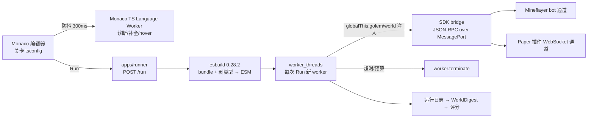

# 03 — 语言选型判断（Language Verdict）

> 状态：v1｜负责人：Lead｜最后更新：2026-10-31
> 上游：`research/language-notes.md`（scout-language，2026-10-31 版本核实）、`BRIEF.md` D1
> 下游：`docs/07-architecture.md`（执行管线）、`docs/04-learning-design.md`（语言能力→教学映射）
> 一句话：**学生语言 = 一个被刻意收窄的 TypeScript 子集（我们叫它 LoomTS）**；不造语言、不用 Racket；TS 没有宏，但用户想要的「给物体写逻辑的 DSL 感」由 SDK 的声明式 API 实现，而不是宏。
> 历史说明（2026-11-01 文档审计）：本文件为设计阶段产物（2026-10-31），保留原始设计结论；实现与当前状态以 `STATUS.md`、`docs/46-playtest-fix-plan.md` 与代码为准。

---

## 0. 判断摘要（5 条）

1. **用 TypeScript（子集）**。真实主流语言、SICP JS 3rd ed 有先例、mineflayer/编辑器/类型服务全在 JS 生态、AI 4 天实现速度最高、异步/并发教学原生。
2. **不自造语言**：不是「不可能」，而是 4 天里它的成本会吃掉关卡、美术、AI 工作流的时间；而且自造语言的「语法可控」优势，用「TS 子集 + SDK + 错误翻译 + 预填骨架」能拿到 80%。
3. **不用 Racket**：宏与 `#lang` 是真的强，但 MC 集成要写跨进程 bridge、UI/3D 全在 JS 侧、AI 4 天实现速度显著更低。Racket 适合另一个产品：「以造语言为主线的 PL 课程」，不是本项目的 4 天版本。
4. **TS 没有宏**（2026 年现状，见 §1）。Babel/SWC 插件是「我们替学生展开」，不是「学生写宏」。因此课程**不承诺宏体验**；用户的「给物体写逻辑」诉求 → 用声明式行为 API（`world.defineBehavior(entity, {...})`）+ tagged template/JSX 风格 DSL 满足。宏/去糖作为 P3 彩蛋（Lab-M）出现。
5. **Hide the noise 是一套工程承诺，不是一句口号**：10 条手段（§3）+ 三档类型强度 + 约 20 条错误翻译；**类型错误永不阻断运行**，语法错误才阻断；学生永远看不到 import/构建/终端/tsc。

## 1. 直接回答：JS/TS 有没有 macro？

**结论：没有。** TypeScript 只有类型系统与降级，没有用户定义宏、卫生宏或语法扩展钩子。2026-10 的生态现状（全部于 2026-10-31 通过 npm/GitHub/官方文档核实）：

| 机制 | 现状【事实】 | 能做到什么 | 为什么不用 |
|---|---|---|---|
| `babel-plugin-macros` | 3.1.0，npm 最后发布 2023-04-29，仓库 2023-05-30 后无推送；Babel 8（2026-06-16）已 ESM-only | 按 import 名做编译期 AST 变换 | 维护停摆 + Babel 8 兼容性未知，项目负债 |
| `ts-patch` + 自定义 transformer | 4.0.1（2026-05-01），README 要求 TS 6+ | 挂到 tsc 流程改 AST、加诊断 | 要 patch 编译器；TS 7 原生兼容性未验证；属内部工具 |
| `ttypescript` | 1.5.15（2023-08-05），已停更 | 旧式 transformer 加载 | 与 TS 5+ 脱节 |
| `sweet.js` | 3.0.15（2023-01-04），已停更 | 真正的卫生宏（独立语言） | 生态死、无法复用 TS 类型与工具链 |
| Babel 自定义插件 | `@babel/core` 8.0.10（2026-10-29） | 任意 AST 改写，可模拟小型宏 | 要自己写自己测；Babel 8 ESM-only 增加配置复杂度 |
| SWC wasm 插件 | `@swc/core` 1.16.21（2026-10-31） | Rust 写插件接 SWC 链 | 开发成本远高于收益 |
| tagged template / JSX | 语言标准，稳定 | 用函数调用做出「像 DSL」的写法 | **这正是我们采用的**：够用、无工具链债 |
| pipeline operator | TC39 **Stage 2**，语法未定；Babel 插件 8.0.1 存在 | `value |> f` 链式 | 不教、不依赖；`pipe()` 函数替代 |
| decorators | TC39 Stage 3，TS 5.0+ 支持 | 类/方法元编程 | 与函数式教学主线关系小 |

**最小能力示例（tagged template 的上限）**：

```ts
// 普通函数调用，运行时执行；没有编译期展开。
const door = world.defineBehavior("village_door", {
  onInteract: async () => { await golem.say("吱呀——门开了") },
  onNight:    async () => { await world.setBlock("redstone_lamp", [10, 64, 10]) },
})
```

这就是用户想要的「给物体写逻辑」：**声明式 API + 回调**，而不是宏。Unity/Godot/Unreal 的实体脚本也是这个形态；对新手而言，它比宏更可理解、更好补全、更好调试。

### 如果一定要「学生可感知的宏」

三条现实路径，按代价排序：
1. **我们自己写一个 Babel 预处理阶段**，暴露 3–5 条固定语法糖（`when`、`unless`、`|>`）给学生——学生感知不到「定义宏」，只感知到「语言有糖」；工程手段，学生学不到宏的心智。
2. **SDK builder + tagged template/JSX 伪装 DSL**（推荐，本项目的选择）——教学上足够表达「声明式」「数据即配置」，但不是宏。
3. **换 Racket**——唯一能给学生真正宏体验的选项，但代价见 §2。

> 判断：**宏不进 4 天课程的核心路径**。如果课程想讲「语言可以被扩展」，Lab-M 用一次 15 分钟的「`|>` 去糖成 `pipe()`」演示即可讲清「语法是皮、语义是骨」，不需要宏系统。这一点与用户愿景（认识 PL 全貌）不冲突：宏是 PL 的一个分支，不是共通抽象的主干。

## 2. 备选语言对比与决策

评分 1–5（5 最好），权重：4 天 AI 交付 30%、MC 集成 25%、新手友好 20%、抽象覆盖 15%、工具链 10%。

| 方案 | 2026-10 状态【事实】 | 4 天交付 | MC 集成 | 新手友好 | 抽象覆盖 | 工具链 | 加权结论 |
|---|---|---|---|---|---|---|---|
| **TypeScript 子集** | TS 6.0.3 / 7.0.2 活跃 | 5 | 5 | 4（靠 §3 手段可到 5） | 5 | 5 | **选用** |
| 自造语言 | — | 2 | 5 | 3 | 3 | 2 | 否决：parser+运行时+编辑器+错误信息+AI 工具链 |
| Racket `#lang` | v9.3（2026-08-13） | 2 | 2 | 2（括号劝退） | 5 | 3（DrRacket 强、我们的 UI 用不上） | 否决：要写 Racket↔Node↔MC bridge；UI/3D 全在 JS |
| Hedy 式渐进语言 | 26.10.17 活跃 | 2 | 2 | 5 | 2（无 ADT/类型） | 4 | 只借鉴「渐进」理念 |
| Pyret | 学术项目，活跃度未核实 | 2 | 2 | 4 | 4 | 3 | 否决 |
| Scala 3 | 3.3.9 LTS | 2 | 2 | 2 | 5 | 3 | 否决（JVM/sbt，太重） |
| ReScript / Gleam / Elm | 均活跃 | 3 | 3 | 3 | 4 | 3 | 否决（生态小、异步/并发教学生态弱） |
| Python | 主流稳定 | 4 | 2（MC 侧无成熟 bot 生态） | 5 | 3 | 5 | 次选：只有 TS 路线全面失败时才考虑 |

**决策理由（按权重）**：
- **MC 集成**：mineflayer 是 JS 生态；服务端插件用 Java，但桥接层、关卡运行时、评分、UI 全在 TS/Node 侧。选 Python/Racket 都要多一层跨语言 bridge，4 天里这是纯风险。
- **AI 交付速度**：LLM 对 TS/React/Node 的代码质量最高；对 Racket/Scala 的熟练度与生态知识明显低。4 天团队是 AI，这是决定性因素。
- **抽象覆盖**：TS 足够承载我们要教的全部 14 个抽象（见 §5）；ADT 用可辨识联合 + `assertNever` 逼近，接口/结构化类型接近 trait/typeclass 的「组合」直觉；async/await 与多 agent 消息是原生强项。
- **SICP 先例**：SICP JS 3rd ed（Source Academy）已经证明「主流 JS + 强脚手架」可以教到高阶函数、数据抽象、元循环求值器——这正是我们的抽象弧线。

**Racket 的诚实评价**：如果这是「一学期、以语言实现为主线」的课，Racket 会是更好的选择：`#lang` 可以让学生真的改语言，DrRacket 的 stepper 是无可替代的 notional machine 教具，宏是真正的 PL 思维训练。但它与本项目的两个硬约束冲突——**MC 视觉舞台**（需要 JS 生态）与 **4 天 AI 交付**。结论是产品定位差异，不是优劣。

## 3. 「LoomTS」正式定义（学生写的东西）

### 3.1 语法白名单/黑名单

| 允许（按关卡渐进解锁） | 禁止/不出现 |
|---|---|
| `const`/`let`、数字/字符串/布尔、模板串、注释、`if/else`、`for`/`while`、函数声明与箭头函数、对象/数组字面量、`type`/`interface`、解构（L6+）、`async/await`（L9+）、生成器（L7+） | `var`、`==`/`!=`（用 `===`/`!==`）、`eval`、`new Function`、原型链操作、`this`（SDK 已绑定）、`class`（L8 只作为反例展示，不允许学生写继承）、`import`（学生不写，SDK 全局注入）、`while(true)` 无退出（观察器兜底） |
| 全局 `golem` / `world` / `allay`（按关卡） | `process`、`require`、`fetch`、`fs`、`WebSocket`、任何 RPC 名 |

- **SDK 不靠 import**：runner 把 SDK 注入 `globalThis`，Monaco 额外 lib 里写 `declare const golem: Golem`；L1–L4 编辑器禁用 import（无补全、无文档）。**L5 起开放模块教学**：学生会写 `import { buildHut } from "./blueprints"`；编辑器提供 `main.ts` + `blueprints.ts` 两个标签页，esbuild 自动打包，学生仍看不到构建配置（模块是语言特性，不是工具链噪音）。
- **顶层 await 允许**（ESM 动态 import 天然支持）；Act I–II 学生不写 `await`，SDK 的写操作按调用顺序入队、程序结束后自动 drain（见 §4.2）；L9 才显式引入 `await` 作为「在等待时能去做别的事」的工具。

### 3.2 三档类型强度（不是 Act，按关卡精确控制）

| 关卡 | tsconfig 关键项 | 设计意图 |
|---|---|---|
| L1–L4 | `strict:false`、`noImplicitAny:false` | 零类型注解；补全里看到类型即文档 |
| L5–L7 | `noImplicitAny:false`、`strictNullChecks:false` | L5 函数参数可注解也可不注解；L6 开始 `type`/联合；L7 出现 `Array<T>`/`Promise<T>` 的自然形态 |
| L8–L10 | `strict:true`（但**类型诊断不阻断运行**） | 接口/异步/并发的类型是教具；编辑器显示「织典警告」，不弹错误墙 |

**永不开启**：`noUnusedLocals`、`noUnusedParameters`、`exactOptionalPropertyTypes`、`noUncheckedIndexedAccess`。
**例外条款**：任何提高类型严格度或引入新语法糖的决定，需 Lead 在 `DECISIONS.md` 书面确认，并且必须同时更新关卡 spec 的 `languageLevel`。

### 3.3 新手错误 → 人话（约 20 条，落地为 `@loom/errors` 纯数据包）

| TS 码 | 触发场景 | 中文翻译模板（填变量名/行号） |
|---|---|---|
| 2304 | 名字拼错/未声明 | 「找不到 `{name}`：检查拼写，或它是后面关卡才教的」 |
| 2322 | 赋值类型不符 | 「`{expr}` 是 {A}，但这里是 {B}」 |
| 2345 | 实参类型不符 | 「第 {n} 个参数需要 {B}，你给的是 {A}」 |
| 2554 | 参数个数不对 | 「`{fn}` 需要 {n} 个参数，你给了 {m} 个」 |
| 2339 | 属性不存在 | 「{T} 没有 `{prop}`；可用：{list}」 |
| 2551 | 属性拼写相近 | 「你是想写 `{suggest}` 吗？」 |
| 7006 | 参数隐式 any（L5+） | 「给参数 `{name}` 加类型，例如 `{name}: number`」 |
| 2531/18047 | 可能为 null | 「`{expr}` 可能是空的，先 `if (...)` 判断」 |
| 18048 | 可能为 undefined | 「`{expr}` 可能是 undefined，用 `??` 给默认值」 |
| 2367 | 比较永不成立 | 「{A} 和 {B} 永远不相等，检查比较两边」 |
| 2741 | 对象缺必填字段 | 「{T} 还缺字段 `{field}`」 |
| 2353 | 对象多写字段 | 「{T} 没有 `{extra}`，是不是拼错了？」 |
| 2454 | 变量未赋值就使用 | 「`{name}` 还没赋值就被用了」 |
| 2448 | 声明前使用 | 「`{name}` 要在使用前定义」 |
| 1005/1128/1109 | 语法错误（缺括号/分号） | 「第 {line} 行附近好像少了 `{token}`」 |
| 2307 | 找不到模块（不该出现） | 「本关不需要 import；直接用 `golem` / `world`」 |
| 2588 | 忘记 `await`（L9） | 「这里是异步操作，前面要加 `await`，不然会带着 Promise 往下跑」 |

规则：**只显示第一条错误**；语法错误阻断运行（并高亮行），类型错误不阻断（编辑器内联标注 + 教练一句话）；错误信息必须包含「哪里错 + 怎么改」两个要素。

## 4. 执行管线（2026 技术事实 + 我们的设计）



### 4.1 版本锁定（2026-10-31 核实）

| 组件 | 锁定版本 | 依据/备注 |
|---|---|---|
| Node | 22.23.1（本机） | 用 worker_threads + ESM；不依赖 isolated-vm |
| TypeScript（语言服务/类型 API） | **6.0.3** | TS 7.0.2 的编程 API 在 `unstable/*`，官方说依赖 API 的项目须用 TS 6 |
| esbuild | 0.28.2 | 剥类型、bundle、plugin API |
| Monaco Editor | 0.57.0 | TS worker、`addExtraLib` 注入 SDK `.d.ts` |
| 运行时沙箱 | `worker_threads` + 超时 terminate | **不用** `node:vm`（官方声明不是安全机制）、**不用** isolated-vm（maintenance mode，7.x 要求 Node ≥26） |
| 包管理 | npm 10.9.8（workspaces） | 本机无 pnpm |

### 4.2 「顺序门面」机制（Act I–II 的关键体验设计；2026-10-31 修订）

> 修订原因：对照方案用 QuickJS Asyncify 证明了「学生无 await、动作按顺序完成」的可行性；本方案的「隐藏 drain」存在读后写不一致风险（如 `const n = golem.collect(...)` 拿到 Promise、随后读缓存可能未更新）。**决定改为 runner 侧 AST 变换自动 await**：Act I–II 在 esbuild 前插入 `await`（`const n = await golem.collect(...)`），保证真正的顺序语义；L9 关闭该变换，让学生显式写 `await`。T1 第 0 小时冒烟验证（变换 + 循环/闭包/表达式 + 类型擦除）。


SDK 操作分两类：
- **读（同步，来自客户端/插件缓存）**：`golem.position`、`golem.count("egg")`、`world.scenario`、`world.clock` —— 直接返回值，不返回 Promise。这让 L2 的计数、L3 的分支不需要 `await`。
- **写（异步，入队，按调用顺序执行）**：`golem.moveTo()`、`golem.place()`、`world.setBlock()` —— 返回 `Promise<void>`，但 Act I–II 允许学生不写 `await`；runner 在「程序主体执行完」后自动 drain 队列，顺序由调用顺序保证。**这就是「顺序执行模式」的真相**：不是语言魔法，是运行时把 await 藏起来了。

L9 的教学钩子正好在这里：**当你要「同时做两件事」时，隐藏的 await 不够用了** —— 你需要在等待时继续写代码，于是 `Promise` 从「被藏起来的东西」变成「摆在手里的东西」：`const brew = startBrewing()` 拿到 Future，先去做别的，最后 `await brew`。这种「先藏后揭示」比第一关就讲 Promise 更符合认知规律。

### 4.3 沙箱与安全（威胁模型）

- 威胁模型：好奇的学生（死循环、误删方块、内存炸弹），**不是**恶意逃逸。
- 手段：worker 隔离 + 每次 Run 新 worker + 3s 超时 `terminate` + 指令预算观察器（Babel traverse 在循环体首插 `__budget.tick()`，体验优化）+ SDK 白名单 + 插件侧再校验（学生代码与 AI 生成关卡数据均视为不可信输入）。
- 真恶意场景不在本项目范围；若未来要上多租户课堂，再引入容器级隔离。

## 5. 语言能力 → 课程抽象映射（为什么 TS 够用）

| 抽象 | TS 承载方式 | 教学形态（关卡） |
|---|---|---|
| A1 顺序 | 语句序列 + 自动 drain | L1 点灯 |
| A2 变量 | `const`/`let` + 可变状态 | L2 计数 |
| A3 分支 | `if/else`、`===`、`&&` | L3 守夜 |
| A4 循环 | `for`/`while`、嵌套 | L4 种田 |
| A5 函数 | 函数声明、参数、`return`、作用域 | L5 造房 |
| A6 模块 | ESM `import`/`export`（学生第一次 import 自己写的 `blueprints.ts`） | L5/L7 |
| A7 记录 | `type` + 对象字面量 + `readonly` | L6 账本 |
| A8 变体 | 可辨识联合 + `switch` + `assertNever` | L6 分拣/工具 |
| A9 闭包 | 箭头函数捕获变量 | L7 悦灵策略 |
| A10 HOF/管道 | `map/filter/reduce` + `pipe()` + `function*` | L7 分拣流水线 |
| A11 接口 | `interface` + 结构化类型 + 多态数组 | L8 机器契约 |
| A12 异步 | `async/await` + `Promise` + `Promise.all` + `try/catch` | L9 破晓 |
| A13 并发 | 多 agent + 消息（SDK 的 `agent()`/`send`/`receive`） | L10 双织者 |
| A14 元语言 | 数据 + 联合 + 解释器函数 | Epilogue |

**TS 的三处「不完美」与我们的处理**：
1. **ADT 不是原生**（没有模式匹配语法）→ `switch` + `assertNever` + 编辑器警告，Codex 页对照 Rust/Haskell 说明「真正的编译器会替你检查穷举」。
2. **interface ≠ typeclass**（动态派发 vs 静态 ad-hoc 多态）→ 课程明确讲「契约/组合」；Codex 页说明 typeclass 的差异，不混淆。
3. **宏缺失** → 见 §1；用声明式行为 API 与 Lab-M 的去糖演示替代。

## 6. 风险与缓解

| 风险 | 触发信号 | 缓解 |
|---|---|---|
| 类型噪音劝退新手 | L5+ 大量 TS 报错 | 三档 strict + 只报第一条 + 不阻断运行 + 骨架预填类型 |
| JS 怪癖泄漏 | 学生写出 `var`/`==`/`this` | AST 检查 4 条 + 补全不出现 + Codex 注明「本课程只教安全子集」 |
| Monaco 内置 TS 与锁定版本不一致 | 编辑器诊断与 runner 不一致 | 固定 Monaco 版本；用 3 个 fixture 做诊断一致性回归 |
| worker 超时不能打断同步死循环 | Day0 冒烟失败 | 退化为子进程隔离（代价：启动慢 ~200ms） |
| TS 版本漂移（7.x 原生编译器） | 未来升级冲动 | 锁 6.0.3；升级需 ADR + 全量回归 |
| 「没有宏」被质疑 | 用户/评审提问 | 用 §1 表格 + 声明式 API 演示回答；Lab-M 展示去糖 |

**如果只能改 BRIEF 的一条决策**：把 D1 的承诺边界写死——「学生语言 = TS 子集（不教宏、类型后置、类型错误不阻断、锁 TS 6.0.3）」。（本文件已按此执行。）

## 7. 来源（2026-10-31 核实）

- npm registry（`npm view <pkg> version time.modified`）：babel-plugin-macros 3.1.0（2023-04-29）、ts-patch 4.0.1（2026-05-01）、ttypescript 1.5.15（2023-08-05）、sweet.js 3.0.15（2023-01-04）、isolated-vm 7.0.2（2026-10-30，engines `>=26`）、esbuild 0.28.2、tsx 4.23.15、typescript 7.0.2/6.0.3/5.9.3、@babel/core 8.0.10、@babel/plugin-proposal-pipeline-operator 8.0.1、monaco-editor 0.57.0、@swc/core 1.16.21、rescript 12.3.1、elm 0.19.3-0。
- TC39 proposals：<https://github.com/tc39/proposals>（Pipeline Operator Stage 2；Decorators/Decorator Metadata/ShadowRealm Stage 3）。
- Babel 8 发布：<https://babeljs.io/blog/2026/06/16/8.0.0>（ESM-only）。
- TypeScript 原生移植公告：<https://devblogs.microsoft.com/typescript/typescript-native-port/>；TS 6.0：<https://devblogs.microsoft.com/typescript/announcing-typescript-6-0/>。
- Node 文档：<https://nodejs.org/api/vm.html>（vm 不是安全机制）、<https://nodejs.org/api/permissions.html>。
- isolated-vm README：<https://github.com/laverdet/isolated-vm>（maintenance mode / Node 版本表）。
- Racket v9.3：<https://github.com/racket/racket/releases/tag/v9.3>；Hedy：<https://github.com/hedyorg/hedy/releases/tag/26.10.17>；SICP JS / Source Academy：<https://about.sourceacademy.org/learner/README.html>。
