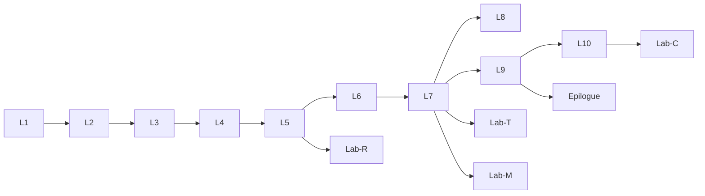

# 05 — 课程骨架与关卡体系（Curriculum Spine）

> 状态：v1（可执行草案）｜负责人：Lead｜最后更新：2026-10-31
> 上游：`docs/04-learning-design.md`（教学法依据）、`research/pedagogy-notes.md`（scout）
> 下游：`content/levels/L01..L10-*.md`（关卡规格）、`docs/06-level-spec-system.md`（规格格式）
> 规则：本文是关卡内容的唯一权威来源。关卡作者（level smith）**不得**改抽象顺序、新增/删除关卡，只能在 spec 里细化；发现问题写进 spec 的「开放问题」。
> 历史说明（2026-11-01 文档审计）：本文件为设计阶段产物（2026-10-31），保留原始设计结论；实现与当前状态以 `STATUS.md`、`docs/46-playtest-fix-plan.md` 与代码为准。

---

## 0. 一句话

10 个关卡、3 个 Act、约 2.5–3.5 小时总时长：玩家用 TypeScript 驱动「织偶」（golem）修复一个被「散线」冻结的 Minecraft 村庄，每关解锁一枚**符文**（= 编程抽象），Act 结局合成织核，终局重启大织机。

## 1. 设计原则（P1–P12，spec 评审 checklist）

| # | 原则 | 可检验的落地方式 |
|---|---|---|
| P1 | **一关一个新抽象，最多两个**；旧抽象必须在关卡里被复用至少一次 | spec 的 `learningObjectives` 与「API 增量表」 |
| P2 | **动机先于语法**：先让玩家感到「没有它很痛」，再给工具 | spec 必有 `painBeat`（<90 秒的失败演示） |
| P3 | **PriMM 节拍**：Predict → Run → Investigate → Modify → Make | spec 的 `beats` 五段式，见 §5 |
| P4 | **MC 地道**：任务必须是 MC 玩家会做的事（点灯/种田/造房/守村/交易/酿造/修桥），禁止「披着 MC 皮的刷题」 | spec 的 `mcAuthenticity` 一节 + reviewer 否决权 |
| P5 | **世界是编译器**：所有反馈优先用世界内语言（粒子/音效/方块/村民/时间），UI 只做最小补充 | `feedback` 表；不许只用 toast |
| P6 | **无死局**：任何状态都能一键重置；卡住 3 分钟必出提示；不惩罚失败 | `reset` 与 `hintLadder` 必须存在 |
| P7 | **多解优先**：评分断言检查目标状态，不检查「唯一写法」 | 断言是 state-based；hidden test 只测行为 |
| P8 | **反硬编码**：每关至少一个隐藏测试用**随机化输入**（大小/坐标/数量/顺序），写死常量必失败 | `hiddenTests` ≥1 |
| P9 | **玩家有手动节拍**：每关结尾至少有一次玩家本人要做的 MC 操作（放最后一块、敲钟、交易、给药水），强化「我在场」 | `playerBeat` 字段 |
| P10 | **视觉高潮**：每关至少一个「值得截图」的瞬间；每 Act 一个 showpiece | `wowMoment` 字段 |
| P11 | **阅读负荷可控，但引导不能省**：教练单条 ≤60 字；一屏目标 ≤3 条；每关有世界状态/任务/为什么是你三句开场；术语首现给一句人话；序章与手记可回看（docs/25） | 文本长度检查 + 5 agent 盲读五问 |
| P12 | **可盲测**：只看关卡 UI 文本（不看 spec）的 solver agent 必须能通关 | 见 §7.3 验收标准 |

## 2. 学习者画像与课程目标

- **画像**：大一/高中，会基本电脑操作；玩过或看过 Minecraft；**多数没有编程经验**，少数会一点 Python/Scratch。
- **课程目标（可测量）**：完成 10 关后，学习者能够
  1. 用 12 个抽象的名字和「它解决什么问题」解释一段陌生代码（口头/选择题）；
  2. 在**没教过的语言**（Python/Haskell/Rust 片段）中认出这些抽象（迁移测验 ≥80%；该目标在正式评估中检验，4 天 demo 的 n=4–6 只作方向性证据）；
  3. 独立完成一个 30 分钟的综合任务（终局关或 Lab-T 断言任务）；
  4. 对「语言设计」产生直觉：语法是皮、抽象是骨、组合优于继承。
- **不追求**：语法覆盖、算法竞赛、工程最佳实践、性能优化。

## 3. 抽象地图（Abstraction Map — 本课程的「全貌」）

> 这是整个游戏的骨架。Codex（图鉴）页面直接由这张表生成，每个抽象有一页「它在 10 种语言里长什么样」。

| ID | 抽象（游戏内符文名） | 它解决的问题 | TypeScript 中的形态 | 跨语言对照（Codex 用） | 关卡 | 掌握证据 |
|---|---|---|---|---|---|---|
| A0 | 求值 / notional machine（织机之心） | 程序不是许愿，是**按顺序被严格执行**的指令 | 表达式、语句、调用求值顺序 | 所有语言；解释器 vs 编译器 | L1 | 能预测「下一句会发生什么」 |
| A1 | 顺序（顺序之符） | 世界按时间发生，动作有先后依赖 | 语句序列、`await` 之前的同步序 | C 语句；Lisp `begin`；Haskell `do`（序也是抽象） | L1 | 4 步无错完成 |
| A2 | 变量/绑定/可变状态（记忆之符） | 程序需要「记住」中间结果；否则每次都从头算 | `const`/`let`、赋值、命名、作用域 | C 变量；Haskell `let`（不可变）；Python 动态绑定 | L2 | 正确计数/保存坐标 |
| A3 | 分支/布尔（抉择之符） | 世界有不同情形，固定动作必错 | `if/else`、比较、`&&`/`||`/`!` | C `if`；Haskell guards；Rust `match` | L3 | 3 个随机场景全过 |
| A4 | 循环/迭代（循环之符） | 重复动作不该靠复制粘贴；规模未知时要能继续 | `for`/`while`、嵌套、终止条件 | C `for`；Python `for-in`；**Haskell 没有循环**（递归/fold） | L4 | 随机尺寸田地 |
| A5 | 函数/分解（函数之符） | 复用与命名：同一行为出现在多处，改一处不该改 N 处 | 函数声明、参数、返回值、作用域 | 所有语言；Haskell 柯里化；C 函数指针 | L5 | 随机地块/风格造房 |
| A6 | 模块/边界（织典之符，轻量） | 东西多了一定要分文件/分边界，否则心智装不下 | `import`/`export`、单文件抽取、命名空间 | C 头文件；Java package；Rust mod；Haskell module | L5、L7 | 抽取 `blueprints.ts` 并被复用 |
| A7 | 记录/积类型（结构之符·上） | 相关信息要绑在一起，否则参数会爆炸且易错位 | `type X = { ... }`、可选字段、`readonly` | C `struct`；Rust `struct`；Haskell record | L6 | 账本/物品建模 |
| A8 | 变体/和类型/模式匹配（结构之符·下） | 「几种互斥情况」要能被类型系统穷举，漏一种编译器就报错 | 可辨识联合 `kind`、`switch` + `assertNever` | Rust `enum`；Haskell `data`；Swift enum；Java sealed | L6 | 新增一种情况时被编译器提示 |
| A9 | 闭包/函数作为值（流动之符·上） | 行为本身是数据：要能传递、保存、稍后执行 | 箭头函数、闭包捕获、回调 | JS/Python/Lisp；C 函数指针无捕获；Rust `Fn` | L7 | 策略函数捕获上下文 |
| A10 | 高阶函数/迭代器/管道/组合（流动之符·下） | 控制流与业务逻辑缠在一起会变成泥巴；组合优于嵌套 | `map/filter/reduce`、`pipe`、generator、惰性 | Haskell `map/.`；Python 推导式；OCaml `|>`；Rust Iterator | L7 | 管道改写后行为不变且更短 |
| A11 | 接口/trait/组合优于继承（契约之符） | 用继承建模「是什么」会把系统焊死；用契约建模「能做什么」才能组合 | `interface`、`implements`、结构化类型、多态数组 | Java interface；Go interface；Rust trait；Haskell typeclass | L8 | 接受「未见过的新机器」 |
| A12 | 异步/Future/错误处理（时间之符） | 等待会阻塞；错误是常态不是异常 | `async/await`、`Promise`、`Promise.all`、`try/catch` | JS Promise；Rust Future；Kotlin suspend；C# Task | L9 | 并发等待赢下截止时间 |
| A13 | 并发/消息传递（双织之符） | 多个执行者共享世界时，协调比算力更难 | 多 agent、消息、共享资源竞争、死锁 | Go goroutine+channel；Erlang actor；Rust 线程 | L10 | 无死锁完成协作任务 |
| A14 | 元语言/数据即程序（元织之符，尾声） | 语言本身可以用数据表示；理解了这一点就理解了「语言的边界是人为的 | 解释器：`Instruction[]` → 执行 | Lisp 同像性；SICP 元循环求值器 | Epilogue Lab | 写出 20 行 mini 解释器 |
| X1 | 递归（递归之符，Lab） | 有些结构是自相似的；循环不是唯一重复方式 | 函数自我调用、base case | Haskell/Lisp 核心；C 需栈理解 | Lab-R | 分形塔正确终止 |
| X2 | 验证/断言（证明之符，Lab） | 「我觉得对」不算对；要让机器帮你检查 | `assert`、测试用例、不变量 | 所有语言的测试框架 | Lab-T | 自写断言全绿 |

> 口径：Codex 共 **17 页** = A0–A14（15）+ X1/X2（2）；其中**核心教学抽象 14 个**（A1–A14；A0 是执行模型/notional machine）。

**明确不在核心路径里的**（见 §9 理由）：继承（只作为反例出现）、monad/函子（Codex 提及，不要求掌握）、底层线程/锁 API、宏作为核心、泛型深水区、GC/内存模型。

## 4. 叙事设定与视觉语言（working title：**织界 / THE LOOM**）

- **设定**：灰岩村（Graystone）曾由「织者」用符文编织世界法则；一场「散线」（The Fray，视觉=蛛网/灰烬/sculk 蔓延）让法则磨损，村庄的织偶全部冻结、作物枯萎。玩家是拾到「织机碎片」的学徒，遇到最后的织者 **艾拉（Eira）**，用她在旅途中留下的**符文石板**逐层修复世界。
- **三幕三核**：Act I 修复**动作之核**（让世界动起来）→ Act II 修复**结构之核**（让世界有秩序）→ Act III 修复**时间之核**（让世界重新运转），终局重启**大织机**。
- **符文 = 抽象**：每关通关获得一枚符文（视觉：附魔台粒子 + 标准银河字母）。符文石板在 UI 的《织典》（Codex）里可回看，且每页有跨语言对照。
- **关卡选择 = 制图台/地图墙**：每个关卡是一张已解锁的地图（棕色羊皮纸 + 地图画），Act 是地图册的章节；未解锁关卡显示为未绘制的空白地图。
- **视觉语言**：附魔台符文粒子、织布机（Loom 方块）与旗帜图案、营火/灯笼暖光、散线=灰色蛛网+sculk 脉动；每 Act 一个「全屏 showpiece」（村庄灯河、织核合拢、破晓金光、桥接完成）。
- **反暴力基调**：修复而非杀戮；战斗最多是「守住村子」；重点在建造、点亮、协调与让村民回家。这与 MC 生存模式的建造乐趣一致。
- **角色**：艾拉（教练，世界内 NPC + UI 对话框）；织偶（玩家命名，默认「灰崽」）；村民（任务委托人，用 MC 村民音效+职业服装）；商队旅商与羊驼（L6）；悦灵（L7）；女巫与僵尸村民（L9）。无反派台词，敌人是「磨损」。

## 5. 每关节拍模板（PriMM + Motivation，所有 spec 必须按此填写）

| 节拍 | 时长 | 做什么 | spec 字段 |
|---|---|---|---|
| 0 动机刺 | 30–90s | 艾拉演示「没有这个抽象会怎样」的失败/麻烦；玩家看到痛点 | `painBeat` |
| 1 Predict | 30–60s | 给出 2–3 行已有代码/骨架，让玩家先猜结果（选择题/改一个参数），先建立心智模型 | `predictBeats[]` |
| 2 Run/See | 1–2min | 跑通给定骨架，看世界变化；一个「啊哈」小瞬间 | `starterCode`、`demoMoment` |
| 3 Investigate | 1–2min | 故意给一个错误/边界情况（错位、越界、类型不对），引导读错误映射 | `investigate`、`commonErrors[]` |
| 4 Modify | 2–4min | 在骨架上改 3–8 行完成主任务（Use→Modify） | `mainTask`、`assertions` |
| 5 Make | 2–5min | 去掉部分脚手架，独立写/扩展到新场景（Create） | `makeTask`、`hiddenTests` |
| 6 玩家节拍 + 结算 | 30–60s | 玩家手动完成最后一步；粒子/音效/advancement/符文解锁 | `playerBeat`、`climax` |

> 关卡时长目标：L1 8–12 min，L2 8–12，L3 10–12，L4 12–15，L5 12–15，L6 15–20，L7 15–20，L8 15–20，L9 15–20，L10 20–25。总 2.5–3.5h。

## 6. 关卡总览

| ID | 标题 | Act | 场景（seed-first POI） | 新抽象 | 核心动词/机制 | 玩家节拍 | 目标时长 | 难度★ | 优先级 |
|---|---|---|---|---|---|---|---|---|---|
| L1 | 第一缕光 | I | 村外黄昏小径（村庄边缘） | A0 A1 | moveTo / place / say | 亲手点第 4 盏灯 | 8–12 | ★ | P0 |
| L2 | 会数数的织偶 | I | 鸡舍与麦田 | A2 | 计数、保存 home 坐标、交蛋 | 引鸡到窝边（演出） | 8–12 | ★★ | P0 |
| L3 | 岔路与钟声 | I | 村口夜巡（钟+铁傀儡） | A3 | 场景试炼 ×3、ringBell、火把 | 天亮敲钟收岗 | 10–12 | ★★☆ | P0 |
| L4 | 麦田的咒语 | I | 农田（黎明/雨天） | A4 | 随机田地、循环跳过水格、while 背包 | 立稻草人（南瓜+干草捆） | 12–15 | ★★★ | P0 |
| L5 | 一百座房子 | II | 平原新地块 + 水井 | A5 A6 | 参数化造房、抽取 blueprints.ts、返回门坐标 | 亲手放门牌（写名字） | 12–15 | ★★★☆ | P0 |
| L6 | 商队的账本 | II | 旅商营地（羊驼+木桶） | A7 A8 | 记录/联合类型、switch+assertNever、账本校验 | 与旅商交易换稀有物 | 15–20 | ★★★★ | P1 |
| L7 | 信风与织线 | II | 信风谷悦灵巢 | A9 A10 | 策略函数、闭包捕获、pipe/map/filter、generator | 打开笼子释放悦灵 | 15–20 | ★★★★ | P1 |
| L8 | 同一种心跳 | II | 织机工坊控制室 | A11 | interface、多态数组、接受新机器、组合 | 拉下总开关 | 15–20 | ★★★★★ | P1 |
| L9 | 破晓之前 | III | 女巫营地（时钟→黎明） | A12 | async/await、Promise.all、错误处理、截止时间 | 治疗僵尸村民 + 敲晨钟 | 15–20 | ★★★★★ | P1 |
| L10 | 双织者 | III | 断裂峡谷 + 大织机遗迹 | A13 | 双 agent、消息、死锁、共享资源竞争 | 放合龙石 | 20–25 | ★★★★★ | P2 |
| L-Epilogue（=L11=EP） | 元织机（尾声） | III | 大织机内部 | A14 | 写 20 行 mini 解释器（数据即程序） | 诵读最后一行符文 | 15–20 | ★★★★ | P2 |
| Lab-R | 递归图腾 | II 后 | 高地 | X1 | 递归函数、base case | — | 5–8 | ★★★ | P2 |
| Lab-T | 证明你的符文 | L7 后 | 工坊 | X2 | assert/测试/不变量 | — | 5–8 | ★★★ | P2 |
| Lab-M | 语法之皮（可选） | III 后 | 织典 | 宏/去糖/语法 vs 语义 | 对比 `|>` 与 `pipe` | — | 5 | ★★★★ | P3 |
| Lab-C | 死锁回廊（可选） | L10 后 | 峡谷 | 死锁变体 | 只用两个邮箱解死锁 | — | 5 | ★★★★ | P3 |

**优先级定义**：P0 = 必须做到完美（前 5 关，撑起垂直切片与教学地基）；P1 = 必须交付（完成「全貌」叙事；若 Day3 中午未开工则按 §7.4 降级）；P2 = 尽力交付（终局 + 尾声 + Lab）；P3 = 可选/演示彩蛋。

**依赖图（严格顺序；Lab 无强依赖）**：

**Act 结局演出**：Act I 末 = 村庄灯河 + 动作之核合拢；Act II 末 = 工坊全部机器同拍运转 + 结构之核；Act III 末 = 大织机重启，散线退去，日出，村民过桥。汇报 demo 只要演 Act I 结局 + 终局，就能讲完整故事。

## 7. 梯度验证（Gradient Audit）

### 7.1 每关负荷清单（spec 必须填，reviewer 检查）

| 关卡 | 新抽象数 | 新 API 符号数 | 新 TS 语法点 | 预计代码行数 | 教练文本预算 | 认知跳跃缓解措施 |
|---|---|---|---|---|---|---|
| L1 | 2（A0,A1） | 4 | 调用、字符串/数字、注释 | 6–10 | 5 条 | 预填骨架 80%，只改坐标 |
| L2 | 1 | 4 | `const`/`let`、赋值、`+` | 10–15 | 6 条 | 先「手动数 3 只」再给变量 |
| L3 | 1 | 3 | `if/else`、比较、`&&` | 15–20 | 7 条 | 3 个场景卡，逐场景解锁 |
| L4 | 1 | 3 | `for`、`while`、嵌套 | 15–25 | 7 条 | 先写 5 行，再问「50 行呢」 |
| L5 | 2 | 3 | `function`、参数、`return` | 25–40 | 8 条 | 先复制粘贴 3 遍再抽函数（对比痛感） |
| L6 | 2 | 4 | `type`、对象字面量、`switch`、`assertNever` | 30–50 | 8 条 | 从「字符串账本」翻车开始；先 2 种 case |
| L7 | 2 | 5 | 箭头函数、`map/filter/pipe`（generator 为可选挑战） | 25–45 | 9 条 | 先写循环版，再「换一种写法」对比 |
| L8 | 1 | 2 | `interface`、`implements`、数组多态 | 25–40 | 9 条 | 先给继承灾难小故事；只加一个新机器 |
| L9 | 1 | 4 | `async/await`、`try/catch`、`Promise.all` | 25–45 | 9 条 | 先顺序版超时失败，再改并发 |
| L10 | 1 | 4 | 多 agent、消息收发、`Promise.all` 复用 | 30–55 | 10 条 | 先单 agent 失败，引出双织者；死锁演示 |

> 判定规则：新 API > 5 或新语法点 > 3 的关卡不通过评审（拆分或改设计）。**计数口径（D17）**：`apiIntroduced` 只计教学符号；同族方法/演出 harness 记 `kind: extension|harness` 另计；docs/12 §4 为准。

### 7.2 抽象覆盖矩阵

| 抽象 | 引入 | 复用/练习 | 高光 | 评估 |
|---|---|---|---|---|
| A0/A1 顺序 | L1 | 所有关 | L1 | L1 预测题 |
| A2 变量 | L2 | L3,L4,L6,L9 | L2 计数 | L2 隐藏计数变体 |
| A3 分支 | L3 | L4,L6,L8,L10 | L3 三场景 | L3 全场景通过 |
| A4 循环 | L4 | L5,L6,L7,L10 | L4 随机田地 | L4 尺寸/位置随机 |
| A5 函数 | L5 | L7,L8,L9,L10 | L5 造房 | L5 随机地块 |
| A6 模块 | L5 末 | L7 | L5 | 文件存在 + 被 import |
| A7 记录 | L6 | L8,L9,EP | L6 账本 | L6 排序断言 |
| A8 变体 | L6 | L8,EP | L6 新增 case 时编译器报错 | L6 隐藏新 case |
| A9 闭包 | L7 | L9,L10 | L7 策略函数 | L7 行为断言 |
| A10 HOF/管道 | L7 | L9(并发收集),EP | L7 一行管道 | L7 行为等价 |
| A11 接口 | L8 | L10 | L8 新机器注入 | L8 grader 注入 mock 机器 |
| A12 异步 | L9 | L10 | L9 破晓 | L9 截止时间 |
| A13 并发 | L10 | — | L10 桥接 | L10 无死锁 + 预算精确 |
| A14 元语言 | EP | — | EP 解释器 | EP 通过 mini 测试集 |
| X1 递归 | Lab-R | — | Lab-R | 分形高度/终止 |
| X2 验证 | Lab-T | 各关隐藏测试 | Lab-T | 自写断言全绿 |

### 7.3 盲测验收标准（每关 spec 必须能被满足）

用一个「盲测 solver agent」：只给关卡 UI 文本 + 当前代码 + 可用 API 文档，**不看 spec、不看参考解**，限时完成。

- 通过：在 ≤15 分钟（L1–L7）/≤20 分钟（L8–L10）内，使用 ≤2 级提示（nudge/technique）完成主任务；
- 强通过：不使用提示在时限内完成；
- 失败处理：solver 卡住的地方 = spec 的歧义/梯度断裂，**修 spec 或关不设计，而不是怪玩家**。
- 另需一个「新手模拟 agent」：假装没有编程经验，只用关卡内出现的词汇，报告每一个「看不懂」的点；每关 ≥3 个困惑点必须被 spec 提前覆盖（`misconceptions`）。

### 7.4 关键跳跃与降级规则

| 跳跃 | 风险 | 缓解 | 若 Day3 中午仍有风险的降级 |
|---|---|---|---|
| L4→L5（函数） | 抽象跃迁大 | 先用「复制粘贴 3 遍」制造痛感；对比动画 | 不降级（P0） |
| L5→L6（记录+ADT） | 双重概念 + TS 类型，负荷最高 | **D5-A8 裁决（2026-10-31）**：保留 L6 的 A7+A8，但重构为「数据建模」单弧两 phase——Phase A 记录（账本/工具字段），Phase B 一种可辨识联合（2 种 kind）+ `switch` + `assertNever`；验收只考「记录建模 + 在已有 switch 里加一种新 kind（注入式隐藏测试）」，不要求学生从零设计联合；教练对话 ≤8 条、脚手架预填类型与 switch 骨架。若盲测 L6 失败率 >40%：降级为只考记录，A8 用 Codex + L8 注入测试带过 | L6 降级为「记录 + 两种 kind 的读代码/改一处」，A8 概念移到 L8 的 Codex 页 |
| L7→L8（接口） | 最抽象的关卡 | 继承小剧场 + mock 机器注入演示 | L8 降级为 Lab（15 分钟工坊挑战），概念用 Codex+L10 带过 |
| L9→L10（并发） | 双 agent 调试难 | 消息日志 UI + 死锁可视化 | L10 降级为 L9 内的「双悦灵协作」彩蛋 + Lab-C |
| EP 解释器 | 需要综合能力 | 只要求 20 行 + 3 条指令 | 砍掉 EP，终局放 L10 |

## 8. 每关细案（Level Briefs）

> 以下每关是 spec 的「骨」，level smith 负责写血肉（逐拍脚本、断言、提示文案、坐标、演出）。禁止改任务本质。

### L1 第一缕光（First Light）
黄昏的村外小径。艾拉把一粒「织偶种子」交给你：它不会思考，只会**严格照着你写的字行动**。天要黑了，小径上 4 盏熄灭的灯笼需要点亮，晚归的村民才能看见路。
- **动机刺**：艾拉展示「手点」方案——跑到第 4 盏灯时天已漆黑，村民摔进沟里（夸张演出、无惩罚）。写一次，织偶一次做完。
- **任务**：用 4 组 `moveTo` + `place("lantern")` 点亮 4 盏灯；顺序不能乱（有段路要过水，必须沿桥走）。
- **新抽象**：A0 求值/notional machine；A1 顺序。**不教**变量/循环。
- **隐藏测试**：检查织偶真的走到每盏灯下才放置（无瞬移/乱放）、没有多放或跳灯；坐标随机化从 L2 起（L1 固定布景，保证第一关可预测）。
- **玩家节拍**：第 4 盏灯由玩家亲手点亮（右键）→ 整条小径同时亮起（粒子+音效），艾拉第一次叫你「织者」。
- **wow**：黄昏→入夜，灯次第亮起，村民沿光走回家，营火点燃，advancement「第一缕光」。
- **符文**：顺序之符。难度★，8–12 分钟。

### L2 会数数的织偶（The Counting Golem）
清晨的鸡舍。村里节日要做蛋糕，需要恰好 6 枚鸡蛋。织偶「没有记性」：它收集了 3 枚就以为自己还没开始，一直兜圈子。
- **动机刺**：艾拉让你先跑「无记忆版」，织偶要么只收 1 枚（记不住已收），要么收到 20 枚（不知停）——村民叹气。
- **任务**：用变量记录已收蛋数、用常量记住鸡舍坐标；收 6 枚、送到木桶、回到艾拉身边。
- **新抽象**：A2 变量/绑定、`const` vs `let`、赋值、命名、作用域直觉（变量属于织偶的「记忆」）。
- **隐藏测试**：随机 6–9 个鸡窝位置；`home` 坐标随机 → 不能写死。
- **玩家节拍**：手持种子把鸡引到窝边（MC 真实行为：鸡会跟随持种子的玩家）；最后一枚蛋由场景计时落下（原版没有「催蛋」，此处是演出处理，不声称原版机制）。
- **wow**：蛋糕出现在桌上、村民围过来、节日铃响。
- **符文**：记忆之符。难度★★。

### L3 岔路与钟声（The Bell at Dusk）
暮色中的村口。最近夜里不太平，艾拉让你写「守夜符文」。固定动作会闯祸：无差别敲钟会把全村吵醒，不点灯又会有僵尸翻墙。
- **任务**：读取当前场景（`world.scenario`：时间、威胁类型、村民是否受困），用 `if/else` 决定：敲钟 / 点灯 / 巡逻 / 安抚。
- **场景试炼机制（本关核心创新）**：写**一个**程序，UI 提供「三夜试炼」按钮，依次跑 3 个随机场景（安静夜/北门僵尸/村民受伤）；全过才通关。让「程序要泛化」变成玩法本身。
- **新抽象**：A3 布尔/比较/`if/else`/逻辑组合；嵌套分支。
- **隐藏测试**：第 4 个场景（组合情形）只出现在验收时。
- **玩家节拍**：天亮时由玩家敲响晨钟收岗（右键钟）。
- **难度与安全**：L3 是唯一需要僵尸的关，单关 `difficulty=normal`；但僵尸由插件按 scenario 生成、不攻击玩家（威胁靠演出），避免新手被杀挫败；其余关卡保持和平难度。
- **wow**：三夜连续剪辑，第三夜成功守卫时铁傀儡向你点头、村民举火把。
- **符文**：抉择之符。难度★★☆。

### L4 麦田的咒语（The Wheat Spell）
黎明的农田。冬天要来，村里需要粮食；25 格田地必须全部种上，还要跳过水渠。
- **动机刺**：艾拉给你看她的旧符文：25 行 `place`，去年田扩大了 3 倍，她写到天亮还没写完；还有一行写错，把种子种进了水里。
- **任务**：`for` 循环种田（先 5×5，再随机 4×6），`while` 在种子耗尽时停，`if` 跳过水格；织偶回到谷仓就算完成。
- **新抽象**：A4 循环、嵌套循环、终止条件、`break`；循环不变量直觉（「每次循环后，前 i 行都种好了」——用旁白引入，不考试）。
- **隐藏测试**：随机田地尺寸/水渠位置/种子数量；写死 25 会失败。
- **玩家节拍**：在田中央用南瓜+干草捆立一个稻草人（原版方块组合）；「作物加速」是织机法则的演出，不声称原版机制。
- **wow**：镜头升起（玩家视角站高台），整片田几秒内被织偶跑位填满，麦浪音效；Act I 结算小演出。
- **符文**：循环之符。难度★★★。

### L5 一百座房子（A Hundred Houses）
平原上的新地块。三户村民要搬来，需要三栋房子；还有第四户要一间「不一样屋顶」的。
- **动机刺**：先让玩家把第一栋房子手写一遍（约 40 行 place），第二栋要求「换个位置再来一遍」——复制粘贴的痛感拉满；第三户说「我们想要圆石地基」，改一处要改 40 行。
- **任务**：写 `buildHut(x, z, style)`，参数化地基/墙/屋顶/门/窗/火把，用它造 3 栋 + 1 种变体；把函数抽到 `blueprints.ts` 并 `import`（A6）；函数返回门的位置，用于放门牌。
- **新抽象**：A5 函数/参数/返回值/作用域/分解；A6 模块（轻量）。
- **隐藏测试**：随机第 5 个地块位置 + 随机风格；`buildHut` 必须泛化。
- **玩家节拍**：在门牌上亲手写下这户人家的名字（UI 输入 → MC 告示牌显示）。
- **wow**：四栋房子同时完成，村民拖家带口入住，烟囱冒烟，晚霞；「建筑师的黄昏」。
- **符文**：函数之符。难度★★★☆。

### L6 商队的账本（The Ledger of the Caravan）
清晨的旅商营地。旅商的羊驼驮着乱七八糟的货物，三个木桶要分别装：工具、材料、食物；每份工作（砍树/挖矿/战斗）要匹配正确的工具。之前的记账符文用字符串硬凑，把「铁镐」和「铁斧」搞混了。
- **动机刺**：给玩家看一份全字符串账本，跑起来把斧头分给了矿工；又来了种新物品「蜜脾」，旧代码全部报错。
- **任务**：用 `type Item`/`type Tool` 记录建模；用可辨识联合（`kind: "axe" | "pickaxe" | "sword"`）表示工具；`switch` + `assertNever` 分拣到正确的桶；返回「这份工作该用哪把工具」。
- **新抽象**：A7 记录/积类型、可选字段、`readonly`；A8 变体和类型、`switch` 穷举、`assertNever`。
- **隐藏测试**：随机货物清单 + 新增一种工具 kind（验收时注入）→ 不更新 switch 会**编译期**报错，学生必须改 case（在关卡里体现为「织典自动标红」）。
- **玩家节拍**：和旅商完成一次真实交易（交出正确材料，换到稀有「织线」；MC 交易 UI）。
- **wow**：三个木桶盖自动合上、羊驼排队离开、商队号角；账本展开成一张发光的清单。
- **符文**：结构之符。难度★★★★。

### L7 信风与织线（The Trade Winds）
信风谷的悦灵巢。悦灵们只会「执行命令」，不会「理解规则」；艾拉要把它们训练成会听「策略」的帮手：给一条规则，它们就能自己分拣。
- **动机刺**：上一版用一坨 `for + if` 写死分拣，每加一条规则就要改整个循环；而且「哪些物品要」和「拿到之后做什么」搅在一起，谁也看不懂。
- **任务**：写策略函数（`const isOre = (item) => item.kind === "ore"`），传给 `allay.assign(strategy)`；用 `pipe(chest.items(), filter(...), map(...), giveTo(...))` 重写分拣；用 generator 给悦灵写无限巡逻路线，用 `take(5)` 安全取用。
- **新抽象**：A9 函数作为值、闭包捕获（策略里捕获「回家的坐标」）；A10 高阶函数/迭代器/管道/组合/惰性。
- **隐藏测试**：随机物品集 + 随机规则组合；同一行为换规则也要过（验证泛化）。允许循环实现，但 UI 会展示「管道版」的对照（不强制）。
- **玩家节拍**：打开笼子（右键）释放悦灵，它们按你的策略飞向箱子。
- **wow**：一屋子悦灵像信风一样穿行，物品在空中划出弧线落入对应箱子；屏幕上你的管道代码高亮流动。
- **符文**：流动之符。难度★★★★。

### L8 同一种心跳（One Heartbeat）
织机工坊的控制室。熔炉组、红石门、警钟三台机器要按同一节拍启动/停止/汇报。艾拉的旧代码用「继承」写：`Machine → Furnace → FurnaceWithBell`，加第四台「熔炉+警钟」时继承树打结了（会演示 diamond 灾难）。
- **动机刺**：给玩家看继承版代码在加新机器时的崩溃；「它们不是同一种东西，但它们都会做同一件事」。
- **任务**：学生**使用** SDK 提供的 `world.machines()`（每台机器结构上满足 `Machine` 契约），写 `runAll(machines: Machine[])` 统一启动、写 `combine()` 把两台机器组合成一台新的；`Machine` 的学生面签名为 `start(): void; stop(): void; status(): string`（引擎内部异步排队，L9 才显式 Promise）。本关不手写三台设备实现——设备由 SDK 提供，学生只写调度与组合逻辑（降低类型语法负担，符合「一关一抽象」）。
- **新抽象**：A11 接口/契约、结构化类型、多态、组合优于继承、依赖注入的直觉。
- **隐藏测试（关键设计）**：grader 在验收时**注入一台你从未见过的机器**（例如 `LoomMachine`）给 `runAll` —— 只会认硬编码类型的写法会失败；用接口写的一行不用改。这直接检验「面向契约」理解。
- **玩家节拍**：拉下总开关（右键拉杆），三台机器同时轰鸣。
- **wow**：工坊齿轮/活塞全动、红石灯依次亮、音效卡点；艾拉说：「你终于开始织『规则』了」。
- **符文**：契约之符。难度★★★★★。

### L9 破晓之前（Before Dawn）
女巫营地外的夜。黎明前必须完成：治愈一名僵尸村民（需要虚弱药水+金苹果）、交付 3 瓶节日药水、在日出前敲晨钟。每步都要等——顺序等会错过黎明。
- **动机刺**：先跑「顺序版」：等酿造 20s、等发酵、等…… bossbar 的黎明倒计时无情走完，失败演出（不惩罚，可重来）。
- **任务**：用 `async/await` 让织偶在等待时做别的事；用 `Promise` 保存「正在进行的酿造」；用 `Promise.all` 让两个酿造台并行；用 `try/catch` 处理缺材料（隐藏场景会缺）并降级方案。
- **新抽象**：A12 异步、Future/Promise 作为值、并发等待、错误处理、截止时间。
- **隐藏测试**：缺一种材料 + 随机黎明时长；必须优雅降级而不是崩溃。
- **玩家节拍**：把治愈药水泼向僵尸村民（MC 真实机制：虚弱+金苹果的演出简化版），日出钟由玩家敲响。
- **wow**：黎明金光、僵尸村民恢复、村民苏醒、晨钟声；bossbar 从红转白。
- **符文**：时间之符。难度★★★★★。

### L10 双织者（The Two Weavers）
断裂峡谷。大织机在对面，最后一幅「合龙纹」要从两岸同时织起。一个织偶来不及，必须两只；但它们会抢材料、会互相等死。
- **动机刺**：先给单 agent 方案——跑到一半天黑了；再给「两只但没有协议」方案——两只卡在中间互相等待，永远不动（死锁可视化：头顶出现「…」气泡 + 时间停住）。
- **任务**：创建两个 agent（`agent("左织")` / `agent("右织")`），用消息约定同步点（`send`/`receive`）；共享材料箱数量刚好（随机 24–32 块），必须精打细算；一个先放「锚块」另一个再铺；避免双方同时抢箱子的竞争。
- **新抽象**：A13 并发/协作、消息传递/actor、共享资源竞争、死锁、协议设计。
- **隐藏测试**：随机材料预算 + 随机一侧起步延迟；必须无死锁、不丢方块、不超时。
- **玩家节拍**：桥合龙前，由玩家把**合龙石**放进中央缺口。
- **wow**：整座桥同时亮起织线、峡谷对面大织机启动、散线退去、日出、村民从桥上走来。全游戏最高潮。
- **符文**：双织之符。难度★★★★★。

### L-Epilogue 元织机（The Loom's Codex，P2）
大织机内部。最后的法则是：**语言本身也可以被写出来**。玩家用 20–30 行代码写一个 mini 解释器，执行艾拉留下的「远古指令表」（数据），让织偶按指令表行动。
- **新抽象**：A14 元语言/解释器/数据即程序。
- **任务**：`type Instruction = {op:"move", dx,dy} | {op:"place", block} | {op:"repeat", times, body}`；写 `run(program)`；给 3 条测试程序；最后运行史诗指令表，让织偶完成最后一笔。
- **隐藏测试**：嵌套 repeat、非法指令（防御性 `assertNever`）。
- **玩家节拍**：诵读（右键附魔台）最后一行符文，全游戏结语。
- **wow**：指令表像乐谱一样流动，最后整个村庄在晨光中「运行」。
- **符文**：元织之符。难度★★★★，15–20 分钟。

### Labs
- **Lab-R 递归图腾（P2）**：用递归函数造一座自相似的分形塔；教 base case 与递归展开；视觉惊艳、代码 10 行。
- **Lab-T 证明你的符文（P2，解锁于 L7 后；`assert` 是 L7 prelude，不在 L6 前出现）**：给一个已建好的装置，要求写 `assert` 断言证明它满足 4 条不变量；全绿才亮信标。教「测试/验证」。
- **Lab-M 语法之皮（P3）**：对比 `pipe(a,b,c)` 与 `|>` 语法糖；演示「语法可以被去糖成函数调用」（用 Babel pipeline 插件或我们的 transformer），点出宏与语言设计。纯可选。
- **Lab-C 死锁回廊（P3）**：只用两个邮箱解经典死锁谜题。

## 9. 被明确裁掉的内容（及理由）

| 内容 | 理由 | 替代 |
|---|---|---|
| 继承（class extends）作为教学内容 | 用户明确认为 composition 更好；4 天不值得；继承作为 L8 反面教材出现即可 | 接口/组合 + 一段「继承灾难」小剧场 |
| 自造语言/宏作为核心 | 风险高、与「真实主流语言」目标冲突；用户也倾向不造语言 | TS + SDK；宏/语言设计作为 Codex/Lab-M 彩蛋 |
| monad/functor/类型类理论 | 对新手过重；本课程目标是「认识全貌 + 动机」不是范畴论 | Codex 一页提及；L8 只讲接口与组合 |
| 底层线程/锁/原子操作 | JS 无此心智模型；并发用 actor/消息更安全也更现代 | L10 actor 模型 |
| 泛型深水区 | TS 泛型对新手陡峭 | 只出现 `Array<T>`/`Promise<T>` 的自然形态 |
| 内存/GC/指针 | 与本课程抽象主线无关 | 不涉及 |
| 算法与数据结构 | 是另一门课；本课只借最小场景 | 不涉及 |

## 10. 与 SICP / HtDP 的对照（汇报时可讲）

| SICP (JS 3rd ed) | 本课程对应 | 差异 |
|---|---|---|
| 1.1 元素与组合（表达式） | L1/L2 | 我们加「世界副作用」，SICP 是纯计算 |
| 1.3 高阶函数 | L7 | 我们用「给悦灵一条策略」制造动机 |
| 2.1 数据抽象 | L6 | 我们用「账本乱了」制造动机 |
| 2.2 序列/迭代器 | L7 | MC 物品流是天然序列 |
| 3.1 赋值与状态 | L2/L10 | 我们直面「共享状态」的并发问题 |
| 3.2 环境/闭包 | L7 | 闭包用「记忆回家坐标」具象化 |
| 4.1 元循环求值器 | Epilogue | 我们只做 20 行 mini 解释器 |

> 本课程相对 SICP 的取舍：**不追求数学严谨与通用计算模型**，而追求「每个抽象都有一个 MC 世界里能感受到的动机」。相对 HtDP：借 design recipe 的「签名→例子→实现」作为关卡 UI 的软引导，但**不教系统化程序设计方法论**。

## 11. 风险与开放问题

1. **TS 类型对新手是否过陡**（L6 起）：若 Blind Solver 在 L6 失败率 >40%，把类型注解改为「全部预填、学生只写值」。
2. **L8 是否超纲**：接口是多门 PL 课的中期内容，新手可能卡住；保留降级为 Lab 的权利（§7.4）。
3. **L10 双 agent 调试体验**：必须有「消息日志」UI 与死锁检测提示，否则会挫败。
4. **玩家手动节拍**是否打断自动化快感：需要在 playtest 中实测（每关 ≤60 秒）。
5. **叙事量**：每关教练文本 ≤10 条；若 playtest 显示玩家跳字，删旁白不加机制。
6. **Act III 时间**：L9/L10 是 P1/P2，若 Day3 中午未开始，按 §7.4 降级，保住 Act I/II 完整。
