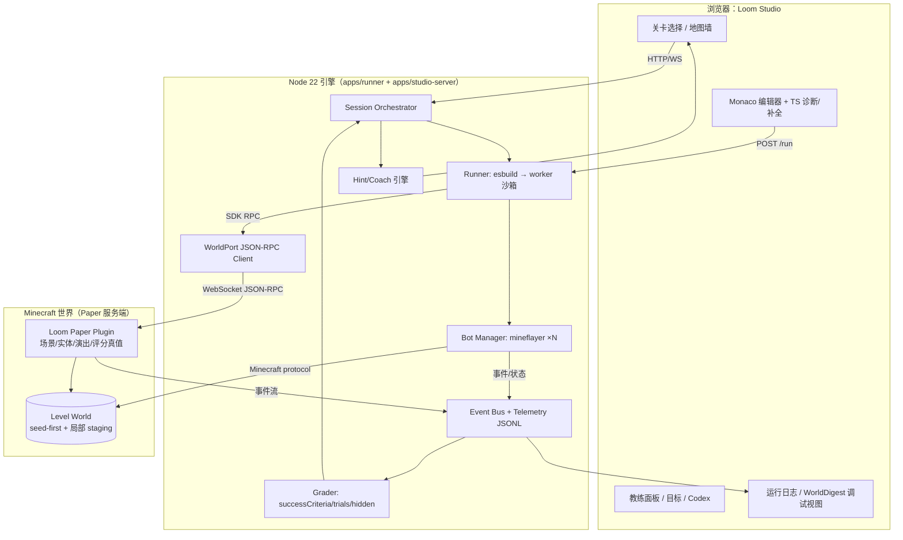
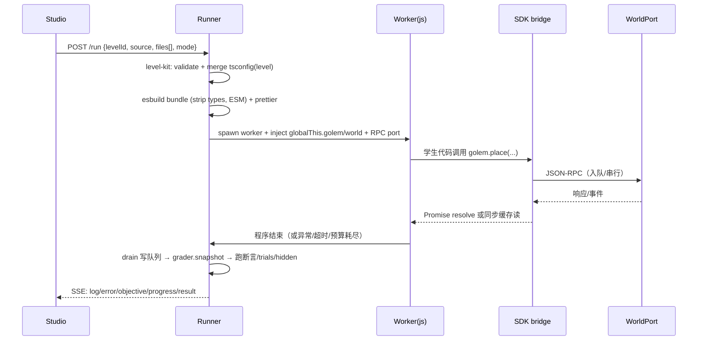

# 07 — 技术架构（Architecture）

> 状态：v1（版本号待 M0 实测锁定，见 `docs/02-minecraft-stack.md`）｜负责人：Lead｜最后更新：2026-10-31
> 上游：`docs/03-language-decision.md`（执行管线）、`research/language-notes.md`、`research/assurance-notes.md`
> 下游：`docs/06-level-spec-system.md`（primitive/断言在运行时的语义）、`docs/09-execution-plan.md`（WBS）
> 一句话：**一个 Node 引擎（编排 + 沙箱 + 评分）+ 一个 Paper 插件（世界权威）+ N 个 Mineflayer 织偶（玩家能力）+ 一个浏览器工作室（UI）；学生只看到两个对象 `golem` 和 `world`。**

---

## 0. 架构总览



**设计要点**：
1. **单一逻辑接口 `WorldPort`**：引擎只认 `WorldPort`（`world.*` 语义），底层有两个真实 adapter（Paper 插件、Mineflayer bot）和一个 fake（record/replay，CI 用）。学生 SDK 不感知通道。
2. **评分真值在服务端**：学生代码所在的 worker 只能读快照、发意图；断言在引擎侧用「插件返回的权威快照 + 事件流」执行，学生进程无法伪造。
3. **每次 Run 一个新 worker**：隔离状态、可强杀超时；关卡状态由引擎重建（reset = 撤场景 + 重放）。
4. **事件流即真相**：所有世界变化以事件形式进入 Event Bus；评分、教练、telemetry、WorldDigest 都消费同一份事件。UI 与 MC 的「视觉」不是真相来源。

## 1. 组件清单与职责

| 组件 | 技术 | 职责 | 不做什么 |
|---|---|---|---|
| `apps/studio` | Vite + React + Monaco 0.57 + Tailwind | 关卡选择、编辑器、教练、目标面板、Codex、调试视图 | 不直接连 MC；不跑学生代码 |
| `apps/runner` | Node 22 + TS（esbuild 编译） | 会话编排；esbuild 打包学生代码；worker 沙箱执行；SDK RPC bridge；评分；提示触发；telemetry | 不直接发 Minecraft 包（bot 由 Bot Manager 管） |
| `packages/protocol` | TS + zod | `WorldPort` 请求/响应/事件 schema；SDK 类型；JSON-RPC 契约 | 不含业务逻辑 |
| `packages/sdk` | TS（浏览器/worker 双端类型） | 学生可见的 `golem`/`world`/`allay` 接口 + 中文 JSDoc；`defineBehavior` 声明式 API | 不暴露 RPC/socket |
| `packages/errors` | TS 纯数据 + 单测 | TS 诊断码 → 中文模板；世界错误 → 人话 | 不依赖 UI |
| `packages/grading` | TS 纯函数 | successCriteria/trials/hiddenTests 执行；`g` 判定 API；随机化种子 | 不读学生代码文本 |
| `packages/worlddigest` | TS 纯函数 | 世界快照 → 紧凑 JSON/ASCII；diff；golden 比较 | 不产生产生副作用 |
| `packages/level-spec` | TS + zod + JSON Schema | `defineLevel()`、validator、按关 tsconfig、代码骨架生成 | 不含具体关卡内容 |
| `plugin/` | Java 25（Paper API，Gradle Wrapper） | 世界/session 管理；SceneScript 执行；实体/NPC/过场；事件上报；评分真值快照 | 不跑学生代码；不解析 TS |
| `bot/` | Node + mineflayer | 织偶连接/重连；移动/挖掘/放置/背包/寻路；状态上报 | 不决定关卡逻辑；不做评分 |
| `content/levels` | `defineLevel()` TS（+ 设计期 MD） | 关卡内容 | — |
| `content/scenes` | JSON/TS 数据 | 参数化道具 builder 与场景 staging | — |
| `it/` | Docker Compose + Node | 真 MC 集成测试（Paper + plugin + bot + runner） | — |
| `qa/` | Node + fresh subagent 调用 | 盲测 solver、红队、spec mutation、novice sim | — |

## 2. 双通道：为什么、边界在哪

### 2.1 能力边界（设计约束，关卡 spec 必须遵守）

| 能力 | Mineflayer bot 通道 | Paper 插件通道 |
|---|---|---|
| 玩家式移动/跳跃/寻路 | ✅（pathfinder） | ❌（服务端不控制客户端移动） |
| 挖掘/放置方块（带手上动作/进度） | ✅ | ✅ 但无玩家动画，适合场景搭建/过场 |
| 背包/箱子/合成 | ✅ | ✅（容器 API） |
| 多执行者 | ✅（多 bot） | ✅（实体） |
| 控 NPC/敌对实体/委派行为 | ❌ | ✅（MobGoals/自定义状态机/display entity） |
| 粒子/音效/title/bossbar/advancement | ❌（客户端侧有限） | ✅ |
| 世界真值（方块/实体/容器） | ❌ 只能看到客户端缓存 | ✅ 权威 |
| 读取场景/评分断言 | ❌ | ✅ |

**关卡设计约束（写入 06 的 validator）**：需要「玩家式动作」的任务走 bot；需要「世界因果/演出/评分」的走插件；任何一条不要跨通道依赖（如 bot 必须读到服务端真值才能继续 → 改设计或加只读同步）。

### 2.2 织偶外观

- bot 是玩家实体 → **用 Paper `Player#setPlayerProfile` 注入「铁皮织偶」纹理**（离线模式可用）；若客户端不显示，退化到 `Mannequin`（26.1.2 实测存在，可 setProfile/命名/转向）或「隐形 armor stand + 名牌」。**resource pack 改不了玩家皮肤/实体模型**（只能改纹理、物品模型、字体、音效），不要把外观压在资源包上。可选穿戴铁头盔/皮革甲增加辨识度。

## 3. 协议设计（WorldPort JSON-RPC 2.0 over WebSocket）

### 3.1 传输与安全

- 插件内嵌 WebSocket server，监听 `127.0.0.1:<port>`（只本机）；引擎作为 client 连接；token 校验（启动时随机生成，写临时文件）。
- 消息：JSON-RPC 2.0；每条请求带 `sessionId`、`seq`；响应带 `ok/error`；事件为 `notify`。
- 全量 zod 校验（引擎侧）+ 插件侧二次校验（学生/场景数据不可信）。
- 超时：单请求默认 500ms（场景构建类 5s）；断线重连 + 指数退避；重连后 `session.resync` 恢复状态。

### 3.2 方法清单（v1）

| 域 | 方法 | 说明 |
|---|---|---|
| session | `session.create(levelId, seed)` / `session.close` / `session.reset` / `session.resync` | 创建世界的隔离会话；reset 重建场景 |
| world | `world.snapshot(region)` / `world.block(pos)` / `world.blocks(region)` / `world.time` / `world.weather` / `world.setTime` | 权威快照与时间控制 |
| scene | `scene.load(sceneId, params)` / `scene.rebuild` / `scene.stage(phase)` / `scene.waitUntil(event)` | SceneScript 执行 |
| entity | `entity.spawn(type, at, opts)` / `entity.despawn` / `entity.animate(id, animation)` / `entity.talk(id, text)` / `entity.setBehavior(id, behaviorId)` | NPC/实体/过场 |
| props | `props.build(builderId, params)` | 参数化道具（灯柱/房子/桥段/仪式圈） |
| fx | `fx.particles(type, at, count)` / `fx.sound(id, at)` / `fx.title(text)` / `fx.actionbar` / `fx.bossbar(name, value)` / `fx.advancement(id)` | 演出 |
| player | `player.teleport(pos)` / `player.freeze(bool)` / `player.gamemode(mode)` | 玩家引导 |
| events | `events.subscribe(types)` → notify `{type, data, seq}` | 世界事件流（方块放置、交互、实体到达、时间点、试炼结束） |
| eval | `grader.snapshot()` | 评分只读快照（含权威方块/容器/实体/事件），引擎用它跑断言 |
| bots | `bots.spawn(count, names)` / `bots.attach(sessionId)` | 通知插件有 bot 加入会话（用于场景/评分识别） |

### 3.3 事件类型（v1）

`block.place` / `block.break` / `player.interact` / `player.item` / `bell.ring` / `potion.splash` / `entity.cured` / `entity.arrive` / `entity.talk` / `agent.arrive` / `agent.stuck` / `agent.say` / `item.move` / `sign.edit` / `trade` / `trade.witch` / `tool.given` / `lever.pull` / `machine.start` / `machine.stop` / `machine.call`（含 `machineId`）/ `patrol.visit` / `budget.exceeded` / `dawn.break` / `run.error` / `scene.phase` / `trial.start` / `trial.end` / `level.complete` / `world.time` / `chat` / `bot.connected` / `bot.disconnected`。**别名**：`cure.splash` ≡ `potion.splash`，`cure.done` ≡ `entity.cured`（spec 里出现别名时必须在 `world.events.aliases` 声明，validator 给 warn）。每个事件含 `{seq, type, actor, actorType, byPlayer, pos, tick, data}`（`data` 里按事件类型带 `block/item/text/got/target/kind/machine/machineId/byGolem` 等字段；`byPlayer` 与 `actorType` 同时存在，语义等价：`byPlayer === (actorType === "player")`），供评分与 WorldDigest 使用；`byPlayer` 由引擎按 `bots.attach` 名单派生（bot 的放置/交互事件 `byPlayer=false`）。

> **`byPlayer` 语义（2026-10-31 定稿）**：bot 也是 player 实体，`BlockPlaceEvent` 对 bot 同样触发。引擎在会话创建时把 bot 名单（`bots.attach`）同步给插件；事件里的 `actorType` ∈ `{player, agent}`，只有 `player` 才是真人（关卡「玩家亲手点第 4 盏灯」类判定必须用它）。

### 3.4 SDK 语义与协议的关系

- 读操作：`golem.position`、`golem.count(item)`、`world.scenario` 从引擎维护的**只读缓存**同步返回（缓存由 bot 状态 + 插件事件持续更新）；
- 写操作：`golem.moveTo()` 等 → engine 入队 → 依次调用 bot/plugin RPC；返回 Promise；
- Act I–II 学生不写 `await`：runner 在程序主体结束后 drain 队列（**顺序模式**，`runMode: "auto-drain"`）；L9 起切 `runMode: "explicit"`（关闭自动 drain，必须显式 `await`），并在 L9 把 worker 超时按 `level.timeLimitSec + 10s` 覆盖默认 3s（否则整关跑不完）。`startBrewing()` 返回 Promise，`Promise.all` 由学生代码直接使用。

## 3.5 会话/权限不变量（吸收自对照方案，D37）

> 目标：让「旧消息、晚到动作、重复提交、取消、重置」都不会污染世界或误判。写成可执行断言（REQ-*），作为 T1 的核心验收项。

| ID | 规则 | 实现要点 |
|---|---|---|
| REQ-EPOCH-01 | 旧 epoch 的消息不能修改当前世界 | 插件每次 reset 递增 `levelEpoch`；所有命令带 epoch，不匹配直接拒绝 |
| REQ-RUN-01 | 只有当前 `runId` 的 capability 能提交动作 | Controller 为每次 Run 发 capability；Stop 后撤销，晚到包被拒 |
| REQ-CMD-01 | 同一 `commandId` 不产生第二次世界效果 | 插件维护当前 epoch 内去重账本（有界 + 过期清理） |
| REQ-STOP-01 | Stop 后不再接受旧运行的新动作 | 撤销 capability → 拒绝新动作 → 清控制/停寻路 → 取消 ticket → 终止 worker → 等 bot 安静 |
| REQ-ITEM-01/02 | 受管物品守恒、数量非负、容量不溢出 | 插件在同一服务器线程做库存预检 + 原子提交（批量失败则整批不生效） |
| REQ-DONE-01 | 动作完成/通关必须有服务器后置条件证据 | COMPLETED 附带 observedTick + 后置快照摘要；评分只信服务端 |
| REQ-RESET-01 | 同一检查点重复 Reset 得到相同规范化状态 | 恢复方块/容器/物品实体/装置/位置/物资 → 读回快照 → 规范化 hash 相等 |
| REQ-REGION-01 | 教学运行只能修改注册对象与区域 | 插件白名单对象 + 边界框 + 保护方块 |

**命令状态机**：`ACCEPTED → EXECUTING → COMPLETED | REJECTED | FAILED | CANCELLED`；`ACCEPTED/EXECUTING` 都不等于成功，UI 只在 `COMPLETED` 后打勾。

## 4. 学生代码执行管线（Runner）



**技术选型（2026-10-31 核实）**：
- 转译/打包：**esbuild 0.28.2**（`bundle: true`，`format: 'esm'`，`platform: 'node'`）；学生多文件 `import` 自然支持；
- 沙箱：**worker_threads**，每次 Run 新建 worker，超时 `terminate`；Node 22.23.1；不用 `node:vm`（官方称非安全机制）、不用 isolated-vm（maintenance mode；7.x 要求 Node≥24，7.0.0 曾要求 ≥26；本项目不用）；
- 循环预算：Babel/AST 在 `for/while` 体首插 `__budget.tick()`（体验优化）；硬超时 3s（可调）；
- 类型检查：Monaco TS worker（editor 端），runner **不跑 tsc**；类型错误不阻断；语法错误阻断；
- 错误翻译：`packages/errors` 纯数据 + 快照测试；只显示第一条。

**多文件/模块（L5 起）**：Monaco 显示 `main.ts` + `blueprints.ts` 两个标签页；runner 以虚拟文件系统（内存 Map）交给 esbuild 解析；学生看不到构建配置。

## 5. 评分与试炼执行

```ts
// 伪代码：runner 中的一次「验收」
const ctx = await worldPort.beginTrial(levelId, trialSeed)
await runStudentCode(ctx)                 // worker，超时 3s + 指令预算
const snap = await worldPort.snapshot(ctx) // 插件权威快照 + 事件流
const result = grader.evaluate(level, snap, trialId)
for (const hidden of level.hiddenTests) { ... }  // 隐藏变体，重跑
```

规则：一次验收 = 主判定 + 所有 trials + 所有 hiddenTests；任一失败给出「方向性」提示（不暴露隐藏输入）；部分完成显示星/勾；随机种子记录，失败可复现。**学生代码从不拿到隐藏测试/断言源码。**

## 6. 场景系统（SceneScript + 参数化道具）

- **SceneScript**：声明式 primitive 数组（见 06 §5.4），插件侧顺序执行，支持 `wait/waitUntil`；
- **参数化道具 builder**（共 28 个，validator 强制 ∈ 清单；新增需 Lead 批准）：`lampPath`、`hut`、`henhouse`、`barnBarn`、`barnBarrel`、`cakeTower`、`bridgeSegment`、`brokenBridge`、`loomWorkshop`、`witchCamp`、`runeStage`、`supplyChest`、`farmPlot`、`signBoard`、`recursionTotem`、`ritualCircle`、`nightWatch`、`wheatField`、`scarecrowHead`、`scarecrowBase`、`villageWell`、`plotRow`、`villagerFamilies`、`caravanCamp`、`allayRoost`、`cageAllays`、`totemPlateau`、`supplyDepot`；关卡通过参数（位置/尺寸/风格/材料）调用；这解决「AI 不会逐方块造景」的问题。**validator 强制 builder 名 ∈ 本清单**，不允许关卡作者发明新 builder（需要时由 Lead 批准加入清单）。
- **seed-first 定位**：`locateAnchor(kind)` 用服务端 `locateNearestStructure/locateNearestBiome` 找村庄/峡谷等 POI，关卡坐标围绕 anchor 计算；演示用 fixed seed 保证复现；
- **重置**：`scene.rebuild` 重放 staging + 清实体 + 恢复玩家位置（≤2s）；不 reload 世界；
- **保护**：`protectedBlocks` 区域禁止学生/场景写操作（村庄建筑、床、门）。

## 7. 教练与提示（Coach Engine）

- 输入：level spec 的 `coach` 脚本（对话框/提示梯/错误映射）+ 运行时状态（失败次数、时间、错误码、代码快照）；
- 规则优先、LLM 可选：4 天内只做**确定性规则引擎**（可靠、可测）；LLM 教练列 P3（需 spec-grounded prompt + fallback）；
- 触发：失败次数、停留时间、错误码、目标完成度、手动点「提示」；
- 输出：UI 面板（文字 + 高亮 codeAnchor）+ 世界内动作（actionbar/title/艾拉 NPC 说话）；
- 防死局：3 级提示 + 60s 后自动补前半段（见 04 §5）。

## 8. WorldDigest（无视觉验收的核心）

世界快照 → 紧凑、稳定、可 diff 的表示：

```json
{
  "levelId": "L03", "trialId": "zombie", "seed": 123456,
  "time": 18000, "weather": "clear",
  "agents": [{ "id": "golem", "pos": [-12.5, 65, 4.2], "state": "idle", "holding": null }],
  "objectives": [{ "id": "bell-ring", "done": true, "evidenceSeq": 42 }],
  "blocks": { "changed": [["-12,65,4", "minecraft:lantern"]] },
  "containers": [{ "pos": "2,64,16", "items": { "minecraft:egg": 6 } }],
  "events": [{ "seq": 42, "type": "block.place", "actor": "golem", "pos": [-12,65,4] }],
  "digestHash": "sha256:…"
}
```

用途：评分断言输入、nightly golden 对比、AI agent 的「眼睛」、失败复现、报告数据。另提供 `worlddigest --ascii` 输出俯视字符图（给 agent/人快速看布局）。

## 9. 仓库结构（monorepo，npm workspaces）

```
loom/                                    # 根
├── apps/
│   ├── studio/                          # React + Vite + Monaco（浏览器工作室）
│   └── runner/                          # Node：session/runner/grader/coach API（HTTP+SSE）
├── packages/
│   ├── protocol/                        # zod schema + JSON-RPC 类型 + 事件
│   ├── sdk/                             # 学生可见类型与运行时 client（golem/world/allay）
│   ├── errors/                          # TS 诊断 → 中文模板（纯数据）
│   ├── grading/                         # 断言执行/判定 API/随机化
│   ├── worlddigest/                     # 快照/diff/ascii/golden
│   └── level-spec/                      # defineLevel + validator + tsconfig + 骨架生成
├── plugin/                              # Paper 插件（Java 25，Gradle Wrapper）
│   ├── src/main/java/...                # session/scene/entity/fx/rpc
│   └── src/main/resources/              # plugin.yml / advancements / 资源包引用
├── bot/                                 # Mineflayer 织偶管理（连接/重连/动作队列/状态上报）
├── content/
│   ├── levels/                          # *.level.ts（内容即数据）
│   ├── scenes/                          # 场景参数与 builder 参数
│   └── codex/                           # A0-A14 跨语言对照页
├── it/                                  # Docker Compose + 真 MC 集成测试
├── qa/                                  # blind solver / red team / spec mutation / novice sim
├── scripts/                             # demo-up.sh / verify.sh / guard-tests / check-links
├── docs/                                # 本目录（Diátaxis 分类）
├── DECISIONS.md  BRIEF.md  STATUS.md
└── package.json（workspaces）
```

## 10. 环境与版本（M0 锁定，Day 1 起不再变）

| 组件 | 版本 | 备注 |
|---|---|---|
| Node | 22.23.1 | 本机；npm workspaces |
| TypeScript | 6.0.3 | 锁；7.x 的原生编译器 API 不稳定 |
| esbuild | 0.28.2 | 转译/打包 |
| Monaco Editor | 0.57.0 | 编辑器 |
| Minecraft / Paper | **26.1.2 build 74** | 锁死；禁止 26.2/26.3（mineflayer #4189） |
| Paper 插件 API | `io.papermc.paper:paper-api:26.1.2.build.74-stable` | Gradle Wrapper 9.8.2 |
| Mineflayer | **4.39.0** | bot 通道（`testedVersions` 到 26.1） |
| minecraft-protocol / pathfinder | 1.68.0 / 2.4.5 | pathfinder 必须配 canDig + timeout |
| Java | **25** | Paper 26.1+ 要求；插件 toolchain 25 |
| 插件 WebSocket 库 | Java-WebSocket 1.6.0（shade 进 jar） | 离线演示不依赖运行时下载 |
| Docker | 29.9.2 + `itzg/minecraft-server:java25` | `--network host`（插件 WS 绑 127.0.0.1） |
| MC 客户端 | Java Edition 26.1.2 | 演示机 Day 0 安装 |
| 测试栈 | Vitest 5.0.5 / Playwright 1.64.1 / fast-check 4.10.2 / Stryker 10.1.1 / zod 4.6.7 | 见 docs/08 |

### 10.1 不可协商的版本锁（M0 实证结论，2026-10-31）

- **锁**：MC/Paper **26.1.2 build 74**（Paper 下载走 Fill API `fill.papermc.io/v3`，sha256 校验） + Java **25** + **mineflayer 4.39.0** + minecraft-protocol 1.68.0 + mineflayer-pathfinder 2.4.5。
- **禁止**：升级到 MC 26.2/26.3——mineflayer issue #4189 实测 join 后 ~1.5s 因缺 `client_tick_end` 被踢；26.1.2 是当前 bot 可用的最新服务端。
- **插件形态**：经典 `plugin.yml`（`api-version: '26.1'`，`libraries:` 或 shadow 依赖），**不要**用 `paper-plugin.yml`（新加载器，复杂度不划算）；Java-WebSocket **shade 进 jar**，保证离线演示可启动。
- **Mineflayer pathfinder 配置**：必须显式 `Movements.canDig` + `goto(goal, timeoutMs)`（不设 timeout 在天然地形实测卡死 90s）；Act I 用短距离/平整路径 + 和平难度，失败由插件 `/tp` 兜底。
- **证据**：`spikes/mc-bot-paper/`（7/7 双通道验证 + 可复现命令）。

## 11. 失败与降级设计

| 失败 | 检测 | 行为 |
|---|---|---|
| MC 服务端崩溃 | 心跳/WS 断开 | 会话暂停；自动重启服务端（demo 脚本）；从最近 checkpoint 恢复场景 |
| 插件 RPC 断开 | WS close | 指数退避重连 + `session.resync`；UI 显示「世界连接中断」 |
| bot 掉线/卡住 | 超时/`agent.stuck` 事件 | 自动重连 + 传送回上一步位置；连续 2 次失败 → 关卡提示「织偶迷路了，重试」 |
| 学生死循环 | worker 超时/预算 | terminate + 「织偶跑了太久」；不惩罚 |
| 断言超时 | 500ms/条 | 判失败并记录（不静默 pass） |
| 场景重建失败 | reset 校验 | 回退到「重载世界」；demo 前预置快照 |
| 版本不兼容 | M0 实测 | 降级方案 A（op-bot 命令通道）/ B（Mock 世界 + 预录） |

## 12. 测试架构（与 08 对应）

| 层 | 对象 | 工具/命令 |
|---|---|---|
| 单元 | grading/worlddigest/errors/level-kit 纯函数 | Vitest + coverage |
| 契约 | protocol schema / SDK 类型 / SceneScript primitive | Vitest + zod golden + `gen-json-schema --check` |
| Property-based | 断言组合、快照归一化、随机化种子、pipeline 组合律 | fast-check（显式 numRuns） |
| 变异 | grading/protocol/worlddigest | Stryker（阈值见 08） |
| 集成 | Paper + 插件 + bot + runner 全链路 | Docker Compose + `it:smoke`（参考解跑每关，比 WorldDigest） |
| E2E | Studio 关键路径（选关→编辑→运行→通过→重置） | Playwright |
| Agentic | 盲测/红队/spec mutation/novice sim | `qa/*`（fresh subagent） |
| 人类 | 可玩性/审美 | CP1/CP2 rubric |

**Mock WorldPort（record/replay）**：把真服一次会话的「快照 + 事件」录成 fixture；CI 里所有关卡验收走 replay，无需 Docker。每日 nightly 比对 replay 与真服同一关的 WorldDigest（diff = P0）。

## 13. 安全与威胁模型

- 威胁：好奇的学生（死循环、误删方块）、AI 生成的关卡数据错误、本地演示误操作；**不是**恶意逃逸/多租户。
- 学生代码：worker 隔离 + 超时 + 内存上限 + 只注入 SDK；不提供 fs/net/process（Node permission model 作为纵深防御，已知它不限制网络——演示只绑 127.0.0.1，威胁模型接受）。
- 插件 RPC：只监听 127.0.0.1 + token；全量 zod + 插件侧校验；场景 JSON 视为不可信输入。
- 世界：`protectedBlocks` 防误改村庄；reset 脚本 & 世界快照可回滚。
- 资产：不向公网分发 MC 资源；内部演示可引用官方资源包/皮肤，公开发布前替换为自制资产（写进局限）。

## 14. 性能预算

| 项 | 预算 | 说明 |
|---|---|---|
| Run 启动（esbuild+worker+SDK ready） | ≤400ms | 目标同屏点击即跑 |
| 评分单条 check | ≤500ms | 纯函数 + 500ms 超时判失败（不静默 pass） |
| 一次验收 evaluate 总预算 | ≤2s | 超时 terminate grading worker；trials/hidden 串行可放宽到 10s 总预算 |
| 单次世界读快照 | ≤100ms | 插件端批量读 |
| 场景重建 reset | ≤2s | demo 重试体验 |
| 关卡验收（含 trials/hidden） | ≤10s | 隐藏测试可后台跑，UI 显示进度 |
| 服务端内存 | ≤3GB | 1 个世界 + 少量实体 |
| 同时 bot 数 | ≤3 | L10 需要 2 个 |
| demo 机器 | 8 核/16GB 推荐 | MC 客户端 + 服务端 + Docker + Studio 同机 |
