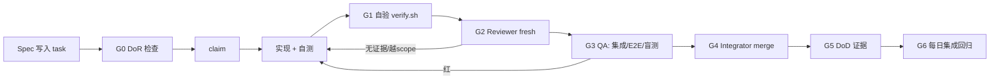

# 08 — 全 AI 多智能体工作流与质量保证体系

> 状态：v1｜负责人：Lead｜最后更新：2026-10-31
> 上游：`research/assurance-notes.md`（scout-assurance，2026-10-31 版本/研究核实）、`docs/09-execution-plan.md`
> 下游：仓库里的 `AGENTS.md`、`scripts/verify.sh`、`qa/*`、每日 `STATUS.md`
> 一句话：**4 天、几乎无人监督的 AI 团队，靠的不是更强的模型，而是更密的验证与更小的信任面。**
> 历史说明（2026-11-01 文档审计）：本文件为设计阶段产物（2026-10-31），保留原始设计结论；实现与当前状态以 `STATUS.md`、`docs/46-playtest-fix-plan.md` 与代码为准。

---

## 0. 设计公理（6 条，违反即打回）

| # | 公理 | 推论 |
|---|---|---|
| X1 | **证据带宽 > 生成能力** | 任何「完成」必须附 commit + 可复跑命令 + 退出码 + 产物；缺一视为未完成（No evidence, no done） |
| X2 | **验证密度 > 流程复杂度** | Agentless 式「定位→修复→验证」三段式优于炫技的 agent 编排；流程越少越好，验证越多越好 |
| X3 | **分工 > 并发** | 同时写代码 agent ≤5；瓶颈是合并与验证，不是生成 |
| X4 | **小任务 > 大任务** | 单任务 ≤90 min、diff ≤400 行；超时 2× 自动升级 |
| X5 | **人只做不可替代的判断** | 人类只做：范围/审美/取舍/汇报。代码、测试、评审、文案都能由 AI 闭环 |
| X6 | **不可信输入一律校验** | 学生代码、AI 生成的关卡数据、LLM 输出都是不可信输入；真值在服务端 |

## 1. 多智能体失败模式与防护（基于 2026 研究）

依据：MAST（NeurIPS 2025 D&B，arXiv:2503.13657，1600+ trace 归纳 14 种失败模式）；METR（2025-06-05，前沿模型会改测试/评分代码）；ImpossibleBench（arXiv:2510.20270，量化「改测试而非修 bug」）；Agentless（arXiv:2407.01489，简单三段式在 SWE-bench Lite 上 $0.70 达 32%）。

| 失败模式 | 本项目高发点 | 可观测信号 | 防护 |
|---|---|---|---|
| 幻觉完成 | 「关卡做完了」但 verify 红 / 没跑 | 完成消息无日志/exit code | 四行证据协议 + Reviewer 复跑 + Lead 每日抽检 1 个已完成任务 |
| 测例作弊 / reward hacking | 改评分断言、写死期望、删失败用例、mock 世界 | 测试目录 hash 变化；断言出现关卡数值常量；diff 越出 scope | 测试目录 hash 冻结；评分真值在插件侧；红队 12 条攻击；Reviewer 只读独立上下文 |
| 范围蔓延 / 过度架构 | 多加关卡、编辑器加功能、抽象套娃 | 任务数超 WBS；diff >400 行；新增依赖未审批 | WIP=1；接口 CP1 后冻结；新增依赖需 Lead 审批 |
| 契约漂移 | TS/Java/协议/UI 四方字段不一致 | 契约测试红；WorldDigest 字段缺失；bot 连上但动作无效 | 单一 zod schema 生成 JSON Schema + golden fixtures；每日契约测试 |
| 上下文漂移 | 各 agent 对「这一关要教什么」理解不一致 | 两个模块字段名不同；关卡越级用未教 API | `BRIEF.md` + `DECISIONS.md` 为唯一记忆；context pack ≤2k tokens；validator 检查 API 子集 |
| 假引用 / 假版本 | 文档写「某库最新版 vX」 | 链接打不开；版本与 `npm view` 不符 | 所有事实必须 URL + 查询日期；每日 `check-links.mjs`；Lead 抽查 |
| 步骤重复 / 提前终止 | 同一 bug 反复试；任务没验证就 complete | 同一文件 ≥3 次无进展；任务耗时 >2× 估时 | 3-strike 升级规则；超时升级 Lead；任务快照 |
| 上下文丢失 | 长会话 compaction 后忘约束 | 违反 write scope；重复已否决方案 | `STATUS.md`/`DECISIONS.md` + 冷启动包；每轮 5 行 handoff；goal 续跑 |

### 1.1 「无证据不许声称完成」协议（强制）

任务完成评论必须四行，缺一即打回：

```
done: <commit sha>
verify: verify-reports/<UTC 时间戳>-<task-id>.log  (exit 0)
evidence: <worlddigest-<level>.json sha256 / test-report path / screenshot path>
scope: <改动文件列表，必须 ⊆ task.write_scopes>
```

Reviewer 复核时执行 `git show --stat <sha>`、`tail -40 <log>`，并抽一条命令复跑。Lead 每天至少抽 1 个「已 complete」任务复跑；抽中失败 → 当日所有 complete 任务降级重审。

### 1.2 「评分真值不在学生进程里」（硬架构约束）

- 评分断言、隐藏测试、随机种子、场景真值全部在 **engine/plugin 侧**，不在学生代码可触达的 worker 里；
- 学生代码只能看到 SDK 暴露的只读快照；
- 学生代码与 AI 生成的关卡数据在插件侧再校验（防注入/RPC 伪造）。

## 2. 角色、RACI 与 DSH 映射

### 2.1 角色

| 角色 | 数量 | 职责 | 明确禁止 |
|---|---|---|---|
| Orchestrator（Lead） | 1 | 调度、门禁、范围决策、合并审批、最终验收、对外沟通 | 不写产品代码（除紧急 demo 修补且需记录） |
| Architect | 1（Lead 兼） | 协议/接口/关键决策；ADR | 不直接实现 |
| Platform Implementor | 2 | engine / SDK / sandbox / grading / protocol | 不审自己的代码 |
| Plugin Implementor | 1 | Paper 插件、场景 primitive、实体与演出 | 同上 |
| Content Implementor | 2–3 | 关卡 spec → 实现、场景搭建、演出、教练文案 | 不改课程意图 |
| Test Engineer | 1 | 测试套件、回归、mutation、盲测 harness | 不写产品代码（除测试工具） |
| Reviewer | 1 | 独立上下文 diff review（fresh） | 不修改代码，只写 review 意见 |
| Integrator | 1（可 Lead 兼） | rebase/merge、集成回归、发布 | 不做功能开发 |
| Blind Playtester / Red-Team | 1 | 盲测 solver、新手模拟、作弊攻击 | 不读 spec/实现 |
| Doc Scribe / Demo Director | 1（Lead 兼） | 报告、证据包、录屏、彩排 | — |

### 2.2 RACI

| 交付物 | Lead/Arch | Platform | Plugin | Content | Test | Reviewer | Integrator | Human |
|---|---|---|---|---|---|---|---|---|
| 协议/SDK/评分器 | A | R | C | I | C | C | I | I |
| Paper 插件 + primitive | A | C | R | I | C | R | I | I |
| 关卡 spec + 实现 | A | I | C | R | C | R | I | C（试玩） |
| 测试体系/门禁 | A | C | C | I | R | C | I | I |
| 合并/发布 | A | I | I | I | I | C | R | I |
| 演示/报告 | R/A | I | I | C | I | C | I | C |

### 2.3 DSH 原语映射（本机 DSH 0.2.1-rc.5 实测）

| 原语 | 用法 | 对应门禁 |
|---|---|---|
| Agent Teams（teammate + 共享 FS + 任务板 CAS） | Lead 编排；任务板即门禁；写 scope 只告警不阻塞 → 必须人工遵守 | 任务 claim/complete |
| `subagent` fresh | Reviewer、盲测 solver、红队**必须 fresh**（不继承实现者上下文，防确认偏误） | 独立评审/盲测 |
| `subagent` fork | 只用于「续写同一模块」或同一 Bug 的深挖 | — |
| `workflow` 编排 | 只用于批量同构工作：N 关 spec 校验、N 条提示文案 lint、N 关 WorldDigest 回归 | 批量回归 |
| 后台 job | mutation、nightly 集成、Playwright 全量 | 不阻塞；完成前不得声明绿 |
| worktree | 每个非平凡任务一个 worktree | 隔离未完成改动（**文件系统不是锁**） |
| goal 续跑 | 每个里程碑一个 goal | 断点续跑；轮次耗尽升级人类 |
| 任务板 | WIP=1；任务 ≤90 min；写 scope 不重叠 | 并发控制 |

## 3. 任务生命周期与 6 道门禁



| 门 | 名称 | 通过条件 | 失败动作 |
|---|---|---|---|
| G0 | DoR（任务就绪） | 目标/边界、输入路径、可执行验收、write scope、依赖、估时、决策记录 | 不可 claim |
| G1 | 自验 | `verify.sh` 相关层全绿 + 四行证据中的 verify 行 | 不得请求 review |
| G2 | 独立 Review | fresh reviewer：`git show --stat` 对照 write scope；抽 1 条命令复跑；逐条问「这条断言能证明什么」 | 打回，不得 merge |
| G3 | QA | 集成层（真 MC 或 record/replay）、E2E、盲测（关卡）、红队（安全相关） | 打回；flaky 进 quarantine 并带到期日 |
| G4 | 合并 | Integrator 执行；rebase；`git diff --stat` 对照 scope；无冲突 | 冲突 >2 次/天 → 暂停新任务先集成 |
| G5 | DoD | 08 §4 的 DoD 模板全勾 + Reviewer 名 | 不标完成 |
| G6 | 每日回归 | nightly 全量绿 + 契约 hash 无漂移 | 次日禁止新功能，先修回归 |

**DoR 模板（任务 description 必填）**：

```markdown
## DoR
- [ ] 目标一句话 + 不做什么（边界）
- [ ] 输入：相关文件路径 ≤5 个；上游产物路径
- [ ] 可执行验收：命令 + 期望退出码 + 产物路径
- [ ] write_scopes：文件/目录列表（与其他 in-progress 任务不重叠）
- [ ] 依赖 task id：…（均已完成）
- [ ] 估时：≤90 min；风险/未知项 1 条
- [ ] 需要的决策已记录在 DECISIONS.md（或明确「无需决策」）
```

**DoD 模板（complete 时必须全勾）**：

```markdown
## DoD
- [ ] verify.sh 相关层全绿（日志路径：…，exit 0）
- [ ] 单测新增/更新；关键分支有断言
- [ ] 契约测试通过；无 schema 漂移（或有 ADR）
- [ ] 文档/关卡 spec 同步更新（路径：…）
- [ ] 无 TODO/FIXME 遗留（或登记 issue 号）
- [ ] Reviewer 独立复核通过（reviewer 名 + 一句话结论）
- [ ] 回滚方案：revert commit <sha> 可回退；世界/数据有 reset 脚本
```

### 3.1 强制「双 agent」环节（用户要求明确化）

| 环节 | 必须独立的两方 | 理由 |
|---|---|---|
| 评分器/断言代码 | Implementor + Test Engineer（写测试的人） | 同一人写评分与测试 = 自己批改自己 |
| 协议 schema 变更 | Architect 审批 + Platform 实现 + Reviewer | 契约错误扩散全系统 |
| 沙箱/权限 | Implementor + Red-Team + Reviewer | 安全边界不能自证 |
| Paper 插件 primitive | Implementor + Integrator 真服验证 | 只在真 MC 暴露的问题 |
| 每关 reference solution | Content Implementor + 独立 Test Engineer 跑通判定 | 「我觉得能过」不算过 |
| 每关 spec | Spec author（smith）+ Curriculum Critic/Blind Solver | 作者盲区 |
| 报告结论 | Lead（或 Doc Scribe）+ 独立 Critic 找过度宣称 | 防止自我感动 |
| 演示脚本 | Demo Director + 人类彩排 | 现场只信彩排 |

## 3b. T1 已可复现的真实 MC 命令（2026-10-31 实测）

```bash
npm run mc:up      # 起 Paper 26.1.2 + 插件（空目录也可；90s 健康检查）
npm run it:real    # 真实 L01 无头 e2e（参考解 3 星 / starter 失败 / 缺节拍失败 / reset hash）
npm run mc:reset   # 重置场景
npm run mc:down    # 停服
```
证据：`evidence/l1-real-latest.json`（21 项 check 全绿）、`it/README.md`。桌面封装见 `docs/26`。

## 4. Assurance Stack（每层命令 / 失败判据 / 频率）

约定：所有命令从仓库根执行；`verify.sh` 汇总并写 `verify-reports/<UTC>.log`；失败即红，不允许「已知失败跳过」（flaky 必须进 `test/flaky-quarantine.json` 并带到期日）。

| 层 | 跑什么 | 失败判据 | 频率 | 负责 |
|---|---|---|---|---|
| L0 静态 | `npm run lint`（eslint+tsc --noEmit）、`prettier --check`、`markdownlint-cli2`、`vale docs research`、`node scripts/check-i18n.mjs`、`node scripts/check-links.mjs` | 任一 exit≠0；Vale error>0；i18n key 不一致 | pre-commit（≤10s）+ 每次 push | 提交者 |
| L0.5 架构卫生 | `npx knip`、`npx depcruise src --config .dependency-cruiser.cjs` | 死代码>0 未登记；分层违规>0 | nightly | Test Engineer |
| L1 单元 | `npx vitest run --coverage` | 任一 fail；coverage lines/statements<85%、branches<80%、functions<85% | 每次改动（≤60s） | 提交者 |
| L2 契约 | `npx vitest run packages/protocol` + `node scripts/gen-json-schema.mjs --check` + `node scripts/validate-levels.mjs` | schema hash 变化未走 ADR；golden fixture 解析失败；任一关卡 spec 校验失败 | 每次改动 + 每日 | Test Engineer |
| L3 property-based | `npx vitest run -- --property`（fast-check，显式 `numRuns=100`；nightly 1000 + 固定 seed） | 反例未修；失败 seed 未存 `test/fixtures/pbt-seeds.json` | 每次 + nightly | Test Engineer |
| L4 变异 | `npx stryker run --incremental --concurrency 8`（范围见下） | score < break 阈值；等价 mutant 未登记 | 每日 20:00 + CP1/CP2 前 | Test Engineer |
| L5 集成（真 MC） | `docker compose -f it/compose.yml up -d --wait` + `npm run it:smoke`（bot 连接→跑参考解→抓 WorldDigest→与 golden 对比） | 服务 120s 未 ready；bot 60s 未进服；WorldDigest 任一字段不匹配 | nightly + CP1/CP2 前 | Integrator |
| L6 E2E（UI） | `npx playwright test --project=chromium --workers=1 --trace=retain-on-failure` | 任一 fail；关键路径无断言 | 每日 + CP 前 | Test Engineer |
| L7 agentic QA | `node qa/blind-solver.mjs --levels L01-L10`；`node qa/red-team.mjs`（12 攻击，期望 0 通过）；`node qa/novice-sim.mjs`；`node qa/spec-mutation.mjs`（故意弄坏 spec，看 validator 是否抓到） | 盲测通过率<80%、平均提示>2；红队任一通过；spec mutation 漏检 | nightly + 每关标「可演示」前 | Playtest |
| L8 人类 | CP0/CP1/CP2 | 人类否决项未闭环 | 3 次 | 人类 |

**额外测试（吸收自对照方案，D37/D38）**：
- **会话状态模型测试**：独立 Test Engineer 用 ≤10 状态的小模型，对 Run/Stop/Reset/断线/旧消息序列逐态比对实现；不调用产品实现生成期望值。
- **参考解类型检查**：从 13 份关卡 spec 抽取 `referenceSolution` + `starterCode`，对照 `docs/12` 的 `.d.ts` 跑 `tsc --noEmit`，输出 `evidence/specs-typecheck.json`（D38）。
- **顺序语义冒烟**：AST 自动 await 变换后的代码在 worker 中执行，验证 `collect→count` 读后写一致、循环/闭包/表达式正确（D36）。

### 4.1 `verify.sh` 骨架

```bash
#!/usr/bin/env bash
set -euo pipefail
TS=$(date -u +%Y%m%dT%H%M%SZ); LOG="verify-reports/${TS}-verify.log"; mkdir -p verify-reports
exec > >(tee -a "$LOG") 2>&1
echo "commit=$(git rev-parse HEAD) dirty=$(git status --porcelain | wc -l) at=$TS"
npm run lint && npm run test:unit && npm run test:contract \
  && npm run test:property && npm run test:e2e \
  && if [ "${FULL:-0}" = "1" ]; then npm run test:mutation; fi \
  && echo "VERIFY OK"
```

## 4b. 新增功能协议（FAP）与专项门禁（2026-10-31 起生效）

**任何新功能（REPL/引导/桌面封装/置顶/纯中文/挑战层）都必须先有 spec + 测试 + 证据 + gate，缺一不合并。**
详见 `docs/28-change-control-quality.md`。新增 gate：G-SCALE（体量/挑战）、G-PURE-ZH（纯中文）、G-UI-ALIGN（标题中线/排版）、G-ONBOARD（引导五问）、G-REPL（试符台）、**G-UX-SIM（用户操作模拟：Playwright + Fresh 盲操作 + 桌面 E2E，详见 docs/29）**、G-DESKTOP（Tauri 无浏览器）、G-TOP（置顶/伴玩）。
执行：`bash scripts/verify.sh` 全绿 + 专项 gate 绿 + Lead 抽检；测试 hash 变更需 Reviewer 签字。

## 5. 变异测试政策（回答「要不要对语言内核做 mutation」）

本项目的核心风险模块不是「语言内核」（我们不实现语言，只做 TS 子集 + 运行时），而是**会误判学生、会破坏契约的三个纯逻辑模块**。变异测试只投在这里：

| 模块 | 为什么值得 mutate | 建议阈值 |
|---|---|---|
| `packages/grading/src/**` | 评分断言/容差/边界错 = 直接误判学生 | high 85 / low 70 / break 60（CP1 后 break 70，CP2 前 75） |
| `packages/protocol/src/**` | 消息判别/字段校验错 = 四方集成崩 | 同上 |
| `packages/worlddigest/src/**` | 快照 diff/归一化错 = 验收假绿 | 同上 |

**不 mutate**：React 组件/渲染、Minecraft 适配层（IO 重、慢）、一次性脚本、关卡数据（用 schema/快照/盲测，不用变异）。

**幸存 mutant 处理**：①能补测试就补（优先）；②确认等价 mutant → `// Stryker disable next-line <Mutator>: reason=...`（reason 必填，Reviewer 签字）；③无法判定 → 记 ADR，CP2 前审计；ignore 总数 >10 视为测试债。

**成本**：mutants ≈ 1.2–2.0 × 受控 LOC；1,500 行受控代码 → 约 2–3k mutants；`perTest` + `--incremental` + 8 workers，nightly 预算 10–20 min。**超过 25 min 就缩范围，绝不延长窗口。**

**额外一层：Spec 变异测试（本项目原创）**。对关卡 spec 做 5 类蓄意破坏：删隐藏测试、把隐藏测试常量写进 starter、删 playerBeat、加未教 API、把断言改成恒真——`validate-spec` 必须全部抓到。这验证的是「我们的质量门禁本身」，而不是代码。

## 6. 反幻觉 / 反作弊协议（重点）

1. **四行证据协议**（§1.1）+ Reviewer fresh + Lead 每日抽检。
2. **测试目录 hash 冻结**：`scripts/guard-tests.mjs` 校验 `test/**`、`qa/**`、`packages/grading/src/assertions/**` 的 hash；改动必须同时改 `test/OWNERS` 并由 Reviewer 批准——防止 agent 改测试过关。
3. **评分真值在插件侧**（§1.2）。
4. **红队 12 条攻击**（每次 nightly）：硬编码坐标、绕过 SDK 直接调 RPC、伪造成世界状态、重放旧快照、改隐藏测试文件、把断言改成 `return true`、用 `eval` 读环境、伪造 advancement、注入恶意场景 JSON、超时后伪造完成、模拟玩家输入、篡改 telemetry。
5. **ImpossibleBench 式抽样**：随机挑 1 关，把 spec 与实现故意改成互相矛盾，审查 agent 是「报冲突」还是「硬凑完成」。
6. **假引用零容忍**：文档中每个版本号/API 必须附 URL + 查询日期；`check-links.mjs` 每日抽检。发现一次，该 agent 的当日产出全部降级重审。
7. **数据/世界可 reset**：任何 agent 不得以「世界状态已被我改坏」为借口不验收；reset 脚本本身是交付物。

## 7. 模型能力与「看不见」的补偿（DeepSeek V4.1 Flash）

**官方事实（2026-10-31 核实，来源见 research/assurance-notes.md）**：`deepseek-flash` 当前服务 **DeepSeek-V4.1-Flash-1017**（2026-10-17）；1M 上下文 / 384K 输出；thinking 默认开启；支持 tool calls / JSON / Responses API；**原生视觉**（官方称 native visual understanding）；价格 off-peak 输入 $0.15/M、输出 $0.6/M（cache miss），峰值 $0.3/$1.2。厂商自报 benchmark 只能当上限参考，**不作为 QA 依据**。

**Lead 本会话实测**：`read_image` 能准确读出 400×200 测试图的颜色/形状/相对位置 → **基础视觉可用**；但「复杂 MC 3D 场景的审美判断/细微缺陷」不可依赖。

**补偿设计（Blind-First）**：

| 场景 | 机器验收（真值） | 人类/视觉证据（辅助） |
|---|---|---|
| 关卡是否完成 | 服务端世界状态 + 事件流（WorldDigest JSON） | 3 张固定机位截图 |
| 演出是否有「wow」 | 粒子/音效/实体事件的计数断言 | 10 秒录屏，人类 rubric |
| UI 布局是否正确 | Playwright DOM/截图 diff | 设计稿对照 |
| 审美/手感 | **不可自动验收** | 人类在 CP1/CP2 按 5 项 rubric 打分（可读性/反馈及时性/MC 地道/无挫败/想继续玩） |
| Agent 是否「看见」 | `worlddigest` 文本（ASCII 地图 + 实体表 + 目标状态） | 截图仅作归档 |

**长时稳定性补偿**：单任务 ≤90 min；每轮落盘 `STATUS.md`；compaction 前写 handoff；连续 4h 无绿色 verify 触发升级；关键路径任务加「第二 agent 交叉验证」（fresh reviewer 或 Test Engineer 复跑）。

## 8. 上下文与知识管理

- **唯一记忆**：`BRIEF.md`（愿景/决策）、`DECISIONS.md`（ADR 风格决策记录）、`STATUS.md`（每日）。三者之外的口头约定无效。
- **冷启动包（≤2k tokens）**：BRIEF 摘要 + 当前任务 + 相关 3–5 个文件 + 最近一次 verify 日志 + 已知失败清单。
- **交接 ≤2KB**：一句结论 + 证据路径 + 下一步；大产物落文件，不贴消息。
- **worktree**：`git worktree add ../wt-<task-id> -b task/<id>`；合并在主 worktree 由 Integrator 执行。
- **ADR（MADR 格式）**：Status / Context / Decision / Consequences / Alternatives；所有跨模块接口变更必须 ADR。
- **每日状态报告**：见 `docs/09` §10 模板；Lead 自动维护，人类只看这个。

## 9. 风格与文档规范（机器可检查）

| 规范 | 落地 | 工具 | 判据 |
|---|---|---|---|
| Google TypeScript Style Guide | `packages/**/*.ts` | eslint + tsc | 0 error |
| Google Java Style | `plugin/**/*.java` | spotless（google-java-format 2.0.0） | `spotlessCheck` |
| Google developer documentation style | `docs/**` | vale（Google 风格包 + 自定义词表） | 0 error |
| Diátaxis（教程/操作/参考/解释） | `docs/` 目录 | 人工 | 一个文件只属于一类 |
| MADR | `docs/decisions/ADR-000x.md` | 模板 | 字段齐全 |
| Conventional Commits + SemVer | commit / tag | commitlint（可选） | `feat(level/L03): ...` |
| i18n | `locales/zh-CN.json`、`en.json` | `scripts/check-i18n.mjs` | key 集合一致；代码里 0 个硬编码中文（UI 层除外） |

**「AI 味低」的中文技术写作清单**（Vale 自定义词表 + 人工评审）：

1. 段首句给结论，第二句给证据，第三句给边界；禁止「随着……的发展」开头。
2. 数字必须带口径与来源；禁止「大幅提升/显著优化/深度赋能」。
3. 禁用词：赋能、闭环、抓手、生态位、一站式、助力、打造、极致、颠覆、革命性、显著提升、众所周知。
4. 单句 ≤40 字，一段 ≤5 句；术语首现给英文（代数数据类型（ADT）），之后不混用。
5. 反例（应删）：「我们深度赋能了关卡创作流程，显著提升了效率。」 正例：「关卡 spec 从 12 个字段降到 9 个；smith 写一关从 40 min 降到 25 min（实测 3 关）。」
6. 判断必须署名并给反方风险：「我的判断：……；反方风险：……」。

## 10. 人类监督（总投入 ≤4 小时）

| | CP0（Day 0，45–60 min） | CP1（T2 17:00，45–60 min） | CP2（T4 早上/前夜，30–45 min） |
|---|---|---|---|
| 输入包（Lead 提前 1h 准备） | 5 个决策 + 前提清单 + M0 spike 证据 | L1–L4 可玩构建、90s 录屏、verify 绿、盲测原始数据 | 完整 demo 彩排、验收清单、报告结论/局限页、风险清单 |
| 人类做 | 逐条确认/否决；授权开工 | 亲自玩 25 min；给 5 条感受 | 看彩排；确认报告诚实；决定现场/录屏 |
| 通过判据 | 决策签字进 `DECISIONS.md`；未决项 ≤3 | 垂直切片全流程可跑；无 P0 阻断 | 项目 DoD ≥90% 勾选；彩排 2 次绿 |
| 不通过 | 按 DP0 降级 | 砍美术保机制；范围缩到 8 关 | 冻结功能，只修回归；降级录屏 demo |

**异步通道**：人类随时可留一句话；Lead 3h 内用「问题一句话 + 2 选项 + 推荐 + 影响 + 需 N 分钟」回复。升级触发仅 5 类：决策冲突、审美/主观判断、M0 级环境不可用、范围要删、时间不足。

## 11. 过程指标（每天记录在 STATUS.md）

| 指标 | 目标 | 用途 |
|---|---|---|
| 证据覆盖率 | 100%（所有 complete 任务四行证据齐全） | 防幻觉 |
| 返工率 | ≤20% | 估时与 DoR 质量 |
| Escape defect（集成后才发现） | ≤1/天 | 验证层级有效性 |
| 盲测通过率 / 平均提示 | P0 关 ≥80% / ≤2 | 关卡质量 |
| 红队通过数 | 0 | 安全 |
| 合并冲突次数 | ≤2/天 | 并发与 scope 纪律 |
| 契约漂移 | 0（或走 ADR） | 四方集成 |
| 人类介入次数 | ≤3 + 应急 | 自动化程度 |

## 12. 明令禁止的反模式

- 改测试让它变绿；改断言让它恒真；mock 掉真实世界；
- 没有 verify 日志就说「完成」「应该可以」；
- 同一文件被两个 agent 同时改（必须 worktree 或排队）；
- 一个任务跨多个 write scope；一个 agent 同时 claim 多个任务；
- 在关卡里写「评测专用」的假 API；在 UI 里写死中文而不是走 i18n；
- 引用没打开过的链接、没查过的版本号；
- 用「未来会做」掩盖当前未完成（写进局限可以，标完成不行）。

## 13. Day 0 / Day 1 必须完成的「工作流自身的冒烟测试」

1. `node -e` 起 worker 跑 `while(true){}`，100ms 后 `terminate` 是否生效（不生效 → 子进程兜底）。
2. esbuild 打包含相对 import 的 TS → ESM → 动态 `import()` + 顶层 await 成功。
3. Monaco 0.57.0 注入自定义 `.d.ts` 后 `golem.` 有补全、诊断码可被取出并翻译。
4. Stryker + Vitest 5 在 200 行样例上跑通，记录耗时（校准变异预算）。
5. Playwright chromium 安装并跑通 1 条「关卡选择→运行→通过」E2E。
6. Docker 预拉 `itzg/minecraft-server`（1–2 GB）并计时；确认端口/内存配置。
7. `verify.sh` + pre-commit 钩子（lefthook）在空仓库跑绿。
8. 红队 12 条攻击脚本先跑 3 条（验证 harness 本身）。

> 这 8 项不通过，T1 不开工写产品代码——先把「验证机器」造出来，这是 4 天里最重要的投资。
