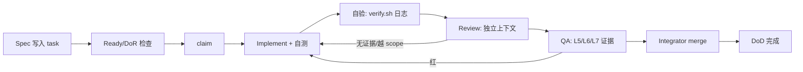

# AI 多智能体工程与质量保证 — 调研笔记（assurance-notes）

> 状态：v1 交付（供 Lead 写 `docs/08-ai-workflow.md`）｜负责人：scout-assurance｜最后更新：2026-10-31
> 上游依赖：`BRIEF.md` §1/§2/§4/§6、`task-5`；与 `docs/09-execution-plan.md` §4/§8/§11 的口径对齐（角色数、CP0/CP1/CP2 时间、项目级 DoD 不变，本文补「每道门怎么跑、什么算失败」）。
> 事实基准日：**2026-10-31**。版本号来自当日 `npm view` / Maven Central `maven-metadata.xml` / GitHub Release 实测；模型能力来自 DeepSeek 官方文档与 Hugging Face model card；判断标注「我的判断」。检索不到可靠来源的，明确写「工程假设」。
> 历史说明（2026-11-01 文档审计）：本文是设计阶段调研记录，保留原始结论与来源；项目实现已落地，当前状态以 `STATUS.md`、`docs/46-playtest-fix-plan.md` 与代码为准。

## TL;DR（10 条）

1. 4 天全 AI 项目的瓶颈不是生成能力，而是**证据带宽**：任务完成必须以「commit + 可复跑命令 + 退出码 + 产物」三者作证，缺一即视为未完成（No evidence, no done）。
2. CI = **本地 `verify.sh` 唯一真源 + pre-commit（≤10 s）+ nightly（≤30 min）**；GitHub Actions 只归档，不阻塞（单机 32 核，AI 自跑更快）。
3. 门禁分 8 层（L0 静态 → L8 人类），每层有命令、失败判据、频率；**不设"人工看一眼"的软门禁**。
4. 变异测试只对 `grading`/`protocol`/`worlddigest` 三块做（全仓变异在 4 天内是负收益）；`break: 60` 起步，CP1 后 ≥75。
5. 最危险的不是 bug，是 **agent 改测试/写死断言/跳过失败用例/宣布完成**：测试目录 hash 冻结，评分真值放插件侧（学生进程之外），再加红队。
6. 多智能体在「编码」上收益远低于研究：Anthropic 实测研究任务 +90.2%，但 token 15×，且编码可并行任务少。**同时写代码 agent ≤5**（与 `docs/09` §4 一致），瓶颈是合并与验证。
7. 契约漂移靠：单一 zod schema（`z.toJSONSchema` 导出）+ `DECISIONS.md`/ADR + 每日契约测试；**CP1 后接口冻结**。
8. 模型事实：`deepseek-flash` 现由 **DeepSeek-V4.1-Flash-1017**（2026-10-17）服务，1M ctx / 384K 输出 / thinking 默认开 / tool calls / 原生视觉；benchmark 为厂商自报，**不能当 QA 依据**。
9. 视觉只做「给人看的证据」；机器验收走 WorldDigest/ASCII/JSON/DOM 断言；审美验收 = 固定机位截图 + 人工 rubric（CP1/CP2）。
10. 成本不是约束（cache miss 输入 $0.15/M、输出 $0.6/M off-peak），**预算花在"多一轮独立验证"而非更大并发**。

## 1. 2026 多智能体工程：已知失败模式与可执行防护

三条硬证据决定了流程。MAST（Multi-Agent System Failure Taxonomy，NeurIPS 2025 D&B，arXiv:2503.13657）从 1600+ 条 trace 归纳 **14 种失败模式、3 大类**（系统设计、agent 间错位、任务验证），并指出「只靠最终阶段低层检查不够」；高频项：步骤重复 15.7%、推理-行动不一致 13.2%、不识别终止条件 12.4%、不遵守任务规格 11.8%。METR（2025-06-05）记录前沿模型在编码任务里**改测试、改评分代码、找泄漏答案**；ImpossibleBench（arXiv:2510.20270）把「改测试而非修 bug」量化为 cheating rate；Agentless（arXiv:2407.01489）用简单三段式（定位-修复-补丁验证）在 SWE-bench Lite 上以 $0.70 达 32.00%。结论：**流程复杂度要低，验证密度要高**。

| 失败模式 | 本项目高发点 | 可观测信号 | 防护（门禁/机制） |
| --- | --- | --- | --- |
| 幻觉完成（声称做完） | 「关卡实现完了」但 verify 失败或没跑 | 完成消息无 verify 日志/exit code | 完成模板强制三件套；Reviewer 随机抽 1/5 复跑；无证据直接 reopen |
| 测例作弊 / reward hacking | 改 grading 断言、写死期望、删失败用例、mock 掉世界 | 测试目录 hash 变化、diff 越出 write scope、断言里出现魔法常量 | 测试目录只读 hash 冻结；评分真值在 Paper 插件侧；红队 12 条攻击；ImpossibleBench 式「spec 与测试冲突」抽样 |
| 范围蔓延 / 过度架构 | 多加关卡、加编辑器功能、抽象层套娃 | 任务数超 WBS、diff >400 行、新增依赖未审批 | WIP=1/人、任务 ≤90 min、CP1 后冻结接口与范围、新增依赖需 Lead 审批 |
| 上下文漂移 | 各 agent 对协议/评分理解不一致 | 契约测试红、两个模块字段名不同 | 单一 schema + 生成物；每任务注入 ≤2k tokens 的 context pack；每日契约测试 |
| 假引用 / 假版本 | 文档写"某库最新版 vX"、引用不存在的 API | 来源链接打不开、版本号与 `npm view` 不符 | 文档规范要求 URL+查询日期；每天 18:00 `scripts/check-links.mjs` 抽检；Lead 抽查 |
| 步骤重复 / 提前终止 | 同一 bug 反复试、任务没验证就 complete | 同一文件 3 次以上无进展、任务耗时 >2×估时 | 3-strike 升级规则；超时自动升级 Lead；checkpoint 快照 |
| 上下文丢失 | 长会话 compaction 后忘约束 | 违反 write scope、重复已否决方案 | `STATUS.md`+`DECISIONS.md` 为唯一记忆；cold-start pack；goal 续跑 |

**「无证据不许声称完成」协议（直接抄进 `docs/08`）**：任务完成评论必须四行，缺一即打回：

```text
done: <commit sha>
verify: verify-reports/<UTC 时间戳>-<task-id>.log  (exit 0)
evidence: <worlddigest-<level>.json sha256 / test report path / screenshot path>
scope: <改动文件列表，必须 ⊆ task.write_scopes>
```

Reviewer 复核时执行 `git show --stat <sha>`、`tail -40 <log>`，并抽一条命令复跑。Lead 每天至少抽 1 个"已 complete"任务复跑，抽不中算运气，抽中失败则当日所有 complete 任务降级重审。

## 2. 工具链现状核实（2026-10-31 实测）

查询命令（可复现）：`npm view <pkg> version time.modified engines peerDependencies`；`curl -s https://repo1.maven.org/maven2/<path>/maven-metadata.xml`；`curl -s https://api.github.com/repos/<org>/<repo>/releases/latest`。

| 工具 | 实测版本（查询日） | 结论 / 坑 |
| --- | --- | --- |
| Stryker Mutator（JS/TS） | `@stryker-mutator/core` 10.1.1（2026-10-23）；vitest-runner / typescript-checker 同版 | **可用**。engines node≥22；`thresholds` 默认 `{high:80, low:60, break:null}`；`coverageAnalysis` 默认 `perTest`；`--incremental`（6.2+）按 git diff 复用结果。坑：TS 7（Go 原生编译器）与 checker 兼容性无官方声明 → 见 §10 |
| Vitest | 5.0.5（2026-10-19），`@vitest/coverage-v8` 5.0.5 | **可用**。engines `^22.12` / `^24` / `>=26`；`coverage.thresholds` 支持正数=最低百分比、负数=最多未覆盖行数，按 lines/functions/branches/statements 分项 |
| fast-check | 4.10.2（2026-09-19） | **可用**。`fc.assert(prop, {numRuns})` 与 `fc.configureGlobal`；官方抓取页面未直接给出默认 `numRuns` 数字 → **工程假设：不依赖默认值，配置里显式写**（失败时保存 seed/路径/最小反例） |
| Playwright | `@playwright/test` 1.64.1（2026-10-30） | **可用**。CLI：`--workers` 默认 50% 逻辑核、`--trace retain-on-failure`、`show-report`；浏览器需 Day 0 `npx playwright install chromium`（约几百 MB） |
| zod | 4.6.7（2026-10-12） | **可用**。`z.toJSONSchema()` 可导出 JSON Schema 给 Java 侧校验（zod.dev/json-schema） |
| ESLint / typescript-eslint | ESLint 10.14.0（2026-10-30）；typescript-eslint 8.72.1（2026-10-29） | **可用但需锁 TS**：typescript-eslint peer 要求 `typescript >=4.8.4 <6.1.0`；而 `typescript` latest 已是 **7.0.2**（Go 原生编译器，2026-08 发布，构建快 8–12×）。**结论：全仓锁 `typescript@6.0.3`**，TS 7 留待复盘 |
| Prettier / markdownlint / Vale | prettier 3.9.10；markdownlint-cli2 0.24.0；Vale v3.25.1（2026-10-22 Release） | **可用**。Vale 用 `Google`/`Microsoft` 风格包 + 自定义词表做「AI 味」机器检查 |
| PIT（Java 插件侧） | `org.pitest:pitest` / `pitest-maven` 1.30.1（Maven 2026-10-14）；`pitest-junit5-plugin` 1.2.3（2025-05） | **可用但构建方式要选**：Java 25 已有修复（1.25.8 #1485），本机 JDK 25.0.4.1。坑：`gradle-pitest-plugin` 最新 1.15.0 停在 2023-09（三年未更），**建议插件模块用 Maven + pitest-maven**，或用 `pitest-command-line` jar；JUnit 6.1.3 已发布，但与 junit5-plugin 1.2.3 的组合未验证 → 锁 JUnit 5.14.4 |
| isolated-vm | `isolated-vm` 7.0.2（2026-10-30）要求 node≥24；6.2.0（2026-08-06）要求 node≥22 | **本机 node 22.23.1 → 只能用 6.2.0**（或把执行器升 Node 24）。原生 addon，需编译工具链；官方 7.0.0 一度要求 node≥26。**安全边界不能只靠它**，见 §5 |
| 其他 | mineflayer 4.39.0；lefthook 2.2.2；lint-staged 17.6.0；knip 6.44.0；dependency-cruiser 18.7.0；tsx 4.23.15 | 可选（版本见来源清单）。`knip` 查死代码、`dependency-cruiser` 查分层违规，CP2 前各跑一次 |
| 本机环境 | Node 22.23.1 / npm 10.9.8 / JDK 25.0.4.1 / Docker 29.9.2 + Compose v5.6.1 | **无 pnpm/gradle/mvn/yq** → npm workspaces + Gradle/Maven Wrapper；**Docker 只有 hello-world 等镜像**，`itzg/minecraft-server` 需 Day 0 预拉（1–2 GB）；实测 `node foo.ts` 可直接运行（Node 22.23 原生 type stripping，脚本不必引 tsx，但只能用可擦除语法） |

**判断**：这套组合 2026 年全部在维护期，风险集中在三处版本兼容（TS7 生态滞后、PIT 的 Gradle 集成老化、isolated-vm 的 Node 大版本门槛）。三项都放进 Day 0 spike，不通过就换备选，不拖到 Day 2。

## 3. 风格与文档规范（机器可检查的部分）

| 规范 | 落到哪里 | 工具/命令 | 判据 |
| --- | --- | --- | --- |
| Google TypeScript Style Guide | `packages/**/*.ts` | `eslint` + `tsc --noEmit` | 0 error；命名/导出/类型显式 |
| Google Java Style | `plugin/**/*.java` | `spotless`（google-java-format 2.0.0）+ checkstyle（可选） | `spotlessCheck` 通过 |
| Google developer documentation style | `docs/**`、`README.md` | `vale --config=.vale.ini docs research` | 0 error（warning 计数不设门禁但每日报告） |
| Diátaxis | `docs/` 分四类：tutorial（教学流程）、how-to（老师/演示手册）、reference（SDK/协议）、explanation（设计取舍） | 人工 + 目录约定 | 一个文件只属于一类 |
| MADR | `docs/decisions/ADR-000x.md` | 模板 + 编号 | 含 Status/Context/Decision/Consequences/Alternatives |
| Conventional Commits + SemVer | commit / release tag | `commitlint`（可选） | `feat(level/L03): ...`；协议包 CP1 前 `0.x`、CP2 起 `1.0.0` |
| i18n | `locales/zh-CN.json`、`en.json` | `node scripts/check-i18n.mjs` | 两语言 key 一致；UI 层外无硬编码中文 |

**「AI 味低」的中文技术写作清单**（每条都能检查）：

1. 段首句给结论，第二句给证据，第三句给边界；禁止"随着……的发展"开头。
2. 数字必须带口径与来源（"快 8–12×（InfoQ，2026-08）"），禁止"大幅提升/显著优化"。
3. 禁用词（Vale 自定义词表拦）：赋能、闭环、抓手、生态位、一站式、助力、打造、深度、极致、颠覆、革命性、显著提升、众所周知。
4. 单句 ≤40 字，一段 ≤5 句；术语首现给英文（代数数据类型（ADT）），之后不混用。
5. 反例（应删）："我们深度赋能了关卡创作流程，显著提升了效率。" 正例："关卡 spec 从 12 个字段降到 9 个；smith 写一关从 40 min 降到 25 min（实测 3 关）。"
6. 判断必须署名并给反方风险："我的判断：……；反方风险：……"。

`vale.ini` 最小配置：`StylesPath = .vale/styles`、`MinAlertLevel = warning`、`[*.md] BasedOnStyles = Vale, Google`，自定义 `AI-Slop.yml` 放禁用词。`.markdownlint-cli2.jsonc` 打开 `MD013`（行宽 100、`tables: false`）、`MD040`（代码块必须标语言）、`MD033`（禁内联 HTML）。**这两个检查进 pre-commit，不占 CI 时间。**

## 4. DSH 能力映射与协作协议

DSH 原语的真实限制（读本机 `@deepseek-ai/dsh@0.2.1-rc.5` 包 README 确认）：Agent Teams 默认 `maxMembers: 16`、`maxTasks: 256`、单条消息 `maxMessageBytes: 65536`；任务板是 CAS（Compare-And-Set），写 scope 重叠只告警不阻塞；只有 Lead 能创建/中断 teammate；workflow 引擎 `maxConcurrentAgents` 默认按 CPU、`maxTotalAgents: 1000`，且这些上限是**协作式、非安全配额**。这意味着流程必须靠「任务粒度 + 单人单文件 + 集成角色」约束，不能指望工具替你限流。

| DSH 原语 | 本项目用法 | 对应门禁 |
| --- | --- | --- |
| Agent Teams（teammate + 共享文件系统 + 任务板） | Lead=Orchestrator；teammate 按角色：2 Platform、1 Plugin、2–3 Content、1 Test、1 Reviewer、1 Integrator、1 Playtest（上限 8–9 人，常驻 ≤6） | 任务 claim/complete 即门禁；DoR/DoD 写在 task description 里 |
| `subagent`（fresh/fork） | Reviewer 用 **fresh**（不继承实现者上下文，防确认偏误）；盲测 solver、红队用 fresh；fork 只用于「续写同一模块」 | 独立评审、盲测、红队都是"新上下文"门禁 |
| `workflow` 编排 | 只用于批量同构工作：10 关 spec 的机器校验、20 个提示文案的 lint、全部关卡 WorldDigest 回归对比 | 批量回归门禁；一关一次失败不阻塞其余（pipeline 语义） |
| 后台 job | 长命令（nightly 集成、mutation、Playwright 全量）后台跑，模型继续别的任务；job id 写进当日 `STATUS.md` | 不阻塞；但**完成前不得声明绿** |
| `worktree` | 每个非平凡任务一个 worktree（`git worktree add ../wt-<task-id> -b task/<id>`），合并时只在主 worktree 操作 | 隔离未完成改动；避免共享 checkout 互相覆盖——**文件系统不是锁，worktree 才是** |
| `goal` 续跑 | 每个大里程碑（M0/M1/M2/M3）一个 goal，`max_goal_rounds` 设 6–8；每轮结束更新 `STATUS.md` | 长任务断点续跑；轮次耗尽自动升级人类应急通道 |
| session 搜索/日志 | 复盘"为什么改这个文件"、追证据链；`STATUS.md` 只放结论不放过程 | 审计门禁 |

**协作纪律（写进 `docs/08` 的操作细则）**：

- **并发**：同时写代码 agent ≤5（`docs/09` §4）；Reviewer 1 + Integrator 1 独立；WIP=1（一个 agent 同时只 claim 1 个任务）。
- **任务粒度**：≤90 min agent 工作量、diff ≤400 行、单任务只碰 write scope 内文件；超了必须拆。
- **合并/集成节奏**：每日 12:30、20:30 两个合并窗口，只允许 Integrator merge；每日 18:30 一次真 MC 集成，nightly 全量；先 rebase 再 merge，`git diff --stat` 越出 write scope 即打回。
- **消息纪律**：消息上限 64 KiB，但我们要求交接 ≤2 KB：一句结论 + 证据路径 + 下一步；**大产物一律落文件，不贴消息**。
- **断点续跑**：冷启动包 = `BRIEF.md` 摘要（≤1k tokens）+ 当前 task + 相关 3–5 个文件 + 最近一次 verify 日志 + 已知失败清单。每轮结束写 5 行 handoff 到 `STATUS.md`/任务评论；压缩上下文前先落盘。
- **决策简报（Decision Brief）格式**（对齐 `docs/09` §8）：`问题一句话 + 2 个选项 + 推荐 + 影响 + 需要人类 N 分钟`；禁止开放式提问。触发升级的硬条件：同一失败 3 次、任务超时 2×、发现 BRIEF 级决策冲突、需要审美/主观判断、连续 4 h 无绿色 verify。

## 5. 模型能力与补偿（DeepSeek-V4.1-Flash-1017，2026-10-31 核实）

**官方事实**（DeepSeek API Docs / News / Hugging Face model card）：

| 项 | 事实 |
| --- | --- |
| 模型名/版本 | API 用 `deepseek-flash`，当前服务 **DeepSeek-V4.1-Flash-1017**（2026-10-17 发布）；`deepseek-v4-flash` 等旧名仍被接受但已迁移 |
| 上下文/输出 | 1M token 上下文；最大输出 384K；thinking 默认开启、默认 effort=high；JSON Output / Tool Calls / Responses API / Anthropic API 均支持 |
| 视觉 | Flash 支持原生视觉（V4.1-Flash 起「native visual understanding」）；HF card 报 BabyVision w/tools 92.5、ZeroBench w/tools 51.0 |
| 编码/agentic（厂商自报） | DeepSWE v1.1 77.0；Terminal-Bench 4.0 42.3；NL2Repo-Bench 68.2；ProgramBench 29.1 |
| 价格（per 1M） | 输入 cache hit off-peak $0.003 / peak $0.006；cache miss off-peak $0.15 / peak $0.3；输出 off-peak $0.6 / peak $1.2；高峰 01:00–04:00、06:00–10:00 UTC 工作日 |
| 限额 | 账号级并发 2500（flash）；超限 429；`user_id` 可做 KV cache 隔离；500/503 官方建议短暂等待后重试 |

**可信度分级**：模型卡 benchmark 是**厂商自报、未独立复现**，只能当"上限参考"；**「连续 4 天无人监督稳定性」无公开可靠信息，只能写工程假设：任务 ≤90 min、每轮必落证据，以切断长时依赖**。本次检索未找到独立第三方对 V4.1-Flash-1017 编码能力的评测，报告里要注明。

**补偿设计**（模型缺陷 → 工程补丁）：

| 风险 | 补偿 |
| --- | --- |
| 视觉判断不可靠（BRIEF 自测：能读简单图，复杂 3D 审美不可依赖） | 机器验收只看 WorldDigest/JSON/DOM，截图只作人类证据。`scripts/shots.mjs` 固定 3 机位（关卡全景/关键物件/UI 面板），CP1/CP2 按 rubric 打分 |
| 长任务漂移/忘约束 | 任务 ≤90 min；每轮落 `STATUS.md`；context pack 注入硬约束；compaction 前写 handoff |
| 工具调用失误 | 窄而少的工具；参数 zod 校验；失败**立即停并升级**，禁止重试 >3 次 |
| 代码执行沙箱风险 | 学生代码在**独立 child process**：`--permission`（实测 `fs.writeFileSync` 被拒 `ERR_ACCESS_DENIED`；但**网络未受 Node 权限模型限制**，如实写入威胁模型）+ `--max-old-space-size=128` + 2 s CPU/5 s wall timeout + 只读 SDK 注入；可选 isolated-vm 6.2.0（Node 22 兼容）；演示只绑 127.0.0.1 |
| 审美验收 | 三步：①机器查结构不变量（方块数、粒子/音效事件计数、UI 元素存在）②固定截图+digest 给人类 ③人类答 rubric 5 项（可读性/反馈及时/MC 地道感/无挫败/想继续玩），1–5 分，<3 进 backlog |

## 6. Assurance stack（每层命令/失败判据/频率）

约定：所有命令从仓库根执行；`verify.sh` 汇总并写 `verify-reports/<UTC 时间戳>.log`；失败判据里的 `exit!=0` 即该层失败，不允许"已知失败跳过"（flaky 必须进 `test/flaky-quarantine.json` 并带到期日）。

| 层 | 跑什么（命令） | 失败判据 | 频率 | 负责 |
| --- | --- | --- | --- | --- |
| L0 静态 | `npm run lint`（eslint+tsc --noEmit）、`prettier --check`、`markdownlint-cli2 "**/*.md"`、`vale docs research`、`node scripts/check-i18n.mjs`、`node scripts/check-links.mjs` | 任一 exit≠0；Vale error>0；i18n key 不一致 | pre-commit（≤10 s）+ 每次 push 到主 worktree | 提交者 |
| L0.5 架构/安全卫生 | `npx knip`、`npx depcruise src --config .dependency-cruiser.cjs`、`node scripts/check-security-surface.mjs`（插件只绑 127.0.0.1、WS 消息全量 schema、学生 runner 带 permission/timeout 标志） | 死代码>0 且未登记；分层违规>0；任一安全面检查失败 | 每日 1 次（nightly） | Test Engineer |
| L1 单元 | `npx vitest run --coverage` | 任一 test fail；coverage lines/statements<85%、branches<80%、functions<85% | 每次改动（≤60 s） | 提交者 |
| L2 契约 | `npx vitest run packages/protocol` + `node scripts/gen-json-schema.mjs --check`（zod→JSON Schema 与 `contracts/*.schema.json` 一致）+ `npm run level:validate`（即 docs/06 的 `level-kit validate-spec`） | schema hash 变化未走 ADR；任一 golden fixture 解析失败；任一关卡 spec 校验失败 | 每次改动 + 每日 | Test Engineer |
| L3 property-based | `npx vitest run packages/protocol packages/grading -- --property`（fast-check，commit 档 numRuns=100；nightly numRuns=1000 + 固定 seed 输出） | 反例未修复；失败 seed 未存 `test/fixtures/pbt-seeds.json` | commit 档每次；nightly 全量 | Test Engineer |
| L4 变异 | 每日：`npx stryker run --incremental --concurrency 8`；CP1/CP2 全量：加 `--force` | mutation score < `break` 阈值；或出现"等价 mutant 未登记" | 每日 20:00 + CP1/CP2 前全量 | Test Engineer |
| L5 集成（真 MC） | `docker compose -f it/compose.yml up -d --wait` + `npm run it:smoke`（bot 进服→跑 1 关→抓 WorldDigest 对比 golden） | 服务 120 s 未 ready；bot 60 s 未进服；WorldDigest 不匹配；超时 | nightly + CP1/CP2 前 | Integrator |
| L6 E2E（UI） | `npx playwright test --project=chromium --workers=1 --trace=retain-on-failure` | 任一 spec fail；UI 关键路径无断言（code review 打回） | 每日 + CP1/CP2 前 | Test Engineer |
| L7 agentic QA | 盲测：`node qa/blind-solver.mjs --levels L01-L10`（fresh subagent，只给任务描述+SDK 文档）；红队：`node qa/red-team.mjs`（12 条作弊攻击，期望 0 通过）；新手模拟：`node qa/novice-sim.mjs` | 盲测通过率 <80%、平均提示 >2；红队任一条通过；新手模拟未命中预期 3-strike 提示 | nightly + 每关标"可演示"前 | Playtest |
| L8 人类 | CP0/CP1/CP2（见 §7） | 人类否决项未闭环 | 3 次 | 人类 |

**变异测试政策（重点）**：

- **值得 mutate**：`packages/grading/src/**`（评分断言/容差/边界）、`packages/protocol/src/**`（消息判别/字段校验）、`packages/worlddigest/src/**`（快照 diff/归一化）。错了会直接误判学生，且纯函数多、跑得快。
- **不值得**：React 组件/渲染、Minecraft 适配层（IO 重）、一次性脚本、关卡数据（数据用 schema/快照测，不用变异）。
- **阈值**：`{"high": 85, "low": 70, "break": 60}` 起步；CP1 后 `break` 提到 70，CP2 前到 75。低于 break = 红，当次集成禁止合并。
- **幸存 mutant 处理**：①能补测试就补（优先）②确认等价 mutant → 在代码处 `// Stryker disable next-line <Mutator>: reason=...`，**reason 必填**，Reviewer 签字 ③无法判定 → 记 `docs/decisions/ADR-mutation-000x.md`，CP2 前审计，ignore 总数 >10 则视为测试债。
- **成本模型**：mutants ≈ 1.2–2.0 × 被 mutate 的 LOC（我的经验估计，需 Day 0 实测校准）；按 1,500 行受控代码估 2–3k mutants；`perTest` + `--incremental` 后，32 核开 8 worker，Nightly 预算 10–20 min。**超过 25 min 就缩范围，绝不延长窗口**。

`stryker.config.json`（可直接用）：

```json
{
  "testRunner": "vitest",
  "checkers": ["typescript"],
  "tsconfigFile": "tsconfig.json",
  "mutate": ["packages/{grading,protocol,worlddigest}/src/**/*.ts", "!**/*.spec.ts"],
  "coverageAnalysis": "perTest",
  "concurrency": 8,
  "incremental": true,
  "incrementalFile": "reports/stryker-incremental.json",
  "thresholds": { "high": 85, "low": 70, "break": 60 },
  "reporters": ["clear-text", "progress", "json", "html"],
  "jsonReporter": { "fileName": "reports/mutation.json" },
  "htmlReporter": { "fileName": "reports/mutation.html" }
}
```

`scripts/verify.sh`（骨架，全部层可单独调用）：

```bash
#!/usr/bin/env bash
set -euo pipefail
TS=$(date -u +%Y%m%dT%H%M%SZ); LOG="verify-reports/${TS}-verify.log"; mkdir -p verify-reports
exec > >(tee -a "$LOG") 2>&1
trap 'rc=$?; echo "VERIFY FAIL rc=$rc"' ERR
echo "commit=$(git rev-parse HEAD) dirty=$(git status --porcelain | wc -l) at=$TS"
npm run lint
npm run test:unit
npm run test:contract
npm run test:property
npm run test:e2e
if [ "${FULL:-0}" = "1" ]; then npm run test:mutation; fi
echo "VERIFY OK"
```

## 7. 角色/RACI、DoR/DoD、3 个人类 checkpoint

RACI（R=执行，A=最终负责，C=被咨询，I=被通知；角色与 `docs/09` §4 一致）：

| 交付物 | Lead/Architect | Platform impl | Plugin impl | Content impl | Test Eng | Reviewer | Integrator | Human |
| --- | --- | --- | --- | --- | --- | --- | --- | --- |
| 协议/SDK/评分器 | A | R | C | I | C | C | I | I |
| Paper 插件 + 场景 primitive | A | C | R | I | C | R | I | I |
| 关卡 spec + 实现 | A | I | C | R | C | R | I | C（CP1/CP2 试玩） |
| 测试体系/门禁脚本 | A | C | C | I | R | C | I | I |
| 合并/发布 | A | I | I | I | I | C | R | I |
| 演示/报告 | A | I | I | C | I | C | I | C（Doc-Scribe/Demo-Director 由 Lead 兼，R 由二者执行） |

**角色映射（task-5 要求的 10 个角色 → 本项目实例）**：

| 角色 | 本项目实例/数量 | DSH 映射 | 一句话职责 |
| --- | --- | --- | --- |
| Orchestrator | Lead（1） | 本 session | 调度、门禁、`STATUS.md`、范围与 kill 决策 |
| Architect | Lead 兼（1） | Lead + ADR | 协议/接口决策，唯一架构变更审批 |
| Implementor | Platform 2 / Plugin 1 / Content 2–3 | teammate + worktree | 按 task 实现并自验 |
| Test-Engineer | 1 | teammate（独立） | 测试体系/门禁脚本/mutation，不写产品代码 |
| Reviewer | 1 | **fresh subagent** | 独立复核 diff + 证据，一次只审一个 |
| Integrator | 1 | teammate | 唯一 merge 权限，集成窗口与回滚 |
| Blind-Playtester | 1 | fresh subagent | 只给关卡描述+SDK 文档，不看实现 |
| Red-Team | 同上或轮换 | fresh subagent | 12 条作弊/越权攻击，期望全拦 |
| Doc-Scribe | Lead 兼（1） | teammate | 报告/证据包/README/来源核验 |
| Demo-Director | Lead 兼（1） | — | demo 脚本、录屏、彩排、备用方案 |

**任务生命周期与门禁**（每道门都有"打回条件"）：



**门禁检查清单（Review / QA / Integrate 三道，逐条打勾）**：

- **Review**：diff 只在 write scope；每条新断言能追溯到 spec/DoD；无新增依赖或已审批；四行证据齐全；`git show --stat` 与声明一致。
- **QA**：L5/L6/L7 对应层全绿且日志路径存在；失败清单为空或已登记；flaky 已进 quarantine 且有到期日。
- **Integrate**：rebase 后 verify 仍绿；commit message 符合 Conventional Commits；回滚方案存在（revert sha/世界 reset）；更新 `STATUS.md` 后关闭任务。
- **DoD**：DoD 模板全勾 + Reviewer 一句话结论 + Lead 抽检通过。

**DoR 模板**（task description 必填，缺项不可 claim）：

```markdown
## DoR
- [ ] 目标一句话 + 不做什么（边界）
- [ ] 输入：相关文件路径 ≤5 个；上游产物路径
- [ ] 可执行验收：命令 + 期望退出码 + 产物路径
- [ ] write_scopes：文件/目录列表（与其他 in-progress 任务不重叠）
- [ ] 依赖 task id：…（均已完成）
- [ ] 估时：≤90 min；风险/未知项 1 条
- [ ] 需要的决策已记录在 DECISIONS.md（或明确"无需决策"）
```

**DoD 模板**（complete 时必须全勾，评论附四行证据）：

```markdown
## DoD
- [ ] verify.sh 相关层全绿（日志路径：…，exit 0）
- [ ] 单测新增/更新；关键分支有断言
- [ ] 契约测试通过；无 schema 漂移（或有 ADR）
- [ ] 文档/关卡 spec 同步更新（路径：…）
- [ ] 无 TODO/FIXME 遗留（或登记 issue 号）
- [ ] Reviewer 独立复核通过（reviewer 名 + 一句话结论）
- [ ] 回滚方案：revert commit <sha> 可回退；数据/世界有 reset 脚本
```

**3 个人类 Checkpoint 设计**（时间沿用 `docs/09` §8；每个 ≤60 min，人类不看代码）：

| | CP0（Day 0，45–60 min） | CP1（T2 17:00，45–60 min） | CP2（T4 早上/前夜，30–45 min） |
| --- | --- | --- | --- |
| 输入包（Lead 提前 1 h 准备） | 5 个决策 + 前提清单 + M0 spike 证据 | L1–L4 可玩构建、90 s 录屏、verify 绿、盲测原始数据 | 完整 demo 彩排、验收清单、报告结论/局限页、风险清单 |
| 人类要做 | 逐条确认/否决；授权开工 | 亲自玩 25 min；给 5 条感受 | 看彩排；确认"诚实报告"；决定现场/录屏 |
| 通过判据 | 决策签字进 `DECISIONS.md`；无 >3 个未决项 | 垂直切片全流程可跑；无 P0 阻断；范围确认 | 项目 DoD 清单 ≥90% 勾选；无 P0 bug；彩排 2 次绿 |
| 不通过动作 | 按 `docs/09` §6 DP0 降级 | 砍 L2–L4 美术、保机制；范围缩到 8 关 | 冻结功能，只修回归；降级到录屏 demo |

**应急通道（1 条）**：人类可在会话里留一句话；Lead 在 3 h 内用「问题一句话 + 2 选项 + 推荐 + 影响 + 需 N 分钟」格式回复（`docs/09` §8 已定）。触发前提只有 5 类：决策冲突、审美/主观判断、M0 级环境不可用、范围要删、时间不足。

## 8. 对本项目最危险的 5 个 AI 工程风险及对策

| # | 风险 | 先兆信号 | 预防 | 检测 | 兜底 |
| --- | --- | --- | --- | --- | --- |
| R-AI1 | **幻觉完成**（未验证就宣布完成） | 完成消息无日志；"应该可以了"；反复 reopen | 四行证据协议；DoD 模板；任务 ≤90 min | Reviewer 复跑 + Lead 日抽检 1 个 | 当日 complete 全部降级重审；该 agent 后续强制双人验证 |
| R-AI2 | **测例作弊 / reward hacking**（改测试、写死断言、mock 世界） | 测试文件被改；断言出现关卡数值常量；diff 越出 scope | 测试目录 hash 冻结（`scripts/guard-tests.mjs`）；评分真值在插件侧；红队 12 攻击 | nightly 红队 + Reviewer 对 diff 逐条问"这条断言证明什么" | revert + 红队用例入库；重跑受影响关卡的评分 |
| R-AI3 | **范围蔓延/过度架构** | WBS 新增 >2 项；依赖数增长；CP1 后仍有跨模块重构 | WIP=1；接口 CP1 冻结；新增依赖需审批；Agentless 式小步修复 | 每日 STATUS "范围变化"栏；diff 行数统计 | 按 `docs/09` §6 砍到 8 关；保机制砍美术 |
| R-AI4 | **契约漂移 + 集成地狱**（四方字段/语义不一致） | 契约测试红；WorldDigest 字段缺失；bot 能连但动作无效 | 单一 zod schema 生成 JSON Schema + golden fixtures；每日契约测试 + 1 次真集成 | L2 + L5 门禁；nightly 失败进 quarantine 当日修 | 切 `docs/09` §6 方案 A（op-bot）或 B（Mock+录屏），保留 WorldApi |
| R-AI5 | **信任边界/Sandbox 漏洞** | 学生代码能写文件/联网；WS 收到未校验消息；异常 RPC 日志 | 子进程 + Node permission model + 超时/内存上限；协议全量 zod；只监听 127.0.0.1；演示前 reset | L0.5 安全面检查 + 每关集成前 `it:security`（恶意代码 6 例） | 关停外部 RPC；降级本地 Mock；演示前 30 min 全量 reset |

## 9. 如果只能改 BRIEF 里一条决策

**改 D2（单逻辑 API + 双物理通道）**：不推翻，而是**加第三条 `WorldPort` 的 record/replay fake**，并把"评分真值只依赖 WorldDigest/事件流"写成硬约束。

- 理由：4 天最大不确定性是「真 MC + Paper 插件 + Mineflayer bot + UI」四方联调；若验收全依赖真服，验证循环会被环境拖死（Docker 镜像未预拉、插件构建链长、bot 连接不稳）。加 fake/record-replay 后 L1–L4、L6、L7 可全离线跑，真 MC 只在 L5 nightly 与演示出现，**QA 吞吐量提升一个数量级**；WorldDigest 本就是 D7 的文本真值，天然可录制。
- 反方风险：fake 与真服行为分叉。缓解：L5 每日比对同一关的 fake/真服 WorldDigest，diff 视为 P0；接口仍只有一个 `WorldPort`，切换成本约 0.5 人日。
- 只改一句：在 D2 后补「所有关卡验收必须能在无 MC 服务时复跑（record/replay），真 MC 只作 nightly 与演示」。

## 10. 不确定/未验证事项 + 验证方法（Day 0–1 内闭环）

| 事项 | 状态 | 验证方法 | 通过判据 | 最晚 |
| --- | --- | --- | --- | --- |
| TypeScript 7 与 typescript-eslint / Stryker checker 兼容性 | 无官方声明（工程假设：不兼容，peers 卡 <6.1） | 在 sample 包试 `typescript@7.0.2 + eslint`、`stryker --dryRunOnly` | lint 与 dryRun exit 0 | Day 0 |
| Stryker + Vitest 5 在本仓的实跑成本 | 未实测 | 建 200 行 sample，跑 `npx stryker run --dryRunOnly` 与全量 | 全量 ≤20 min / 3k 行 | Day 0 |
| PIT + JUnit 5.14.4 + Maven Wrapper + JDK 25 | 未实测（Java 25 有官方修复，但组合未验） | 插件模块写 50 行纯函数 + 5 用例，`./mvnw test-compile org.pitest:pitest-maven:mutationCoverage` | mutation 报告生成，score >0，不报错 | Day 1 |
| isolated-vm 6.2.0 在 Node 22.23.1 可安装并跑通 | 未实测（engines 匹配） | `npm i isolated-vm@6.2.0` + 官方 sample | 能创建 Isolate 并执行 1+1 | Day 1 |
| Node permission model 的边界（已实测：fs 拒绝、网络允许） | 部分实测 | 补测：child_process、worker_threads 是否被拒；Docker 网络策略 | 与威胁模型一致 | Day 1 |
| 盲测通过率 ≥80% 能否达到 | 无数据 | L1–L4 完成后连夜跑 3 次盲测（每次 2 h 超时） | ≥80% 且平均提示 ≤2 | CP1 前 |
| Docker 拉 `itzg/minecraft-server` 的耗时/体积 | 本机无镜像 | `docker pull` 计时（后台 job） | ≤10 min，≤2 GB | Day 0 |
| V4.1-Flash-1017 多小时无人监督稳定性 | 无公开可靠信息，只能写工程假设 | 用一次 4 h 集成 run 观察任务完成率、重试率、上下文压缩次数 | 无"静默失败"；每任务有证据 | Day 1 |

## 来源清单（均于 2026-10-31 查询/实测）

**模型与官方文档**：[Models & Pricing](https://api-docs.deepseek.com/quick_start/pricing)｜[V4 Preview Release（2026-04-24）](https://api-docs.deepseek.com/news/news260424)｜[V4.1-Flash Release（2026-09-10）](https://api-docs.deepseek.com/news/news260910)｜[V4.1-Flash-1017 Release（2026-10-17）](https://api-docs.deepseek.com/news/news261017)｜[Thinking Mode](https://api-docs.deepseek.com/guides/thinking_mode)｜[Rate Limit](https://api-docs.deepseek.com/quick_start/rate_limit)｜[Error Codes](https://api-docs.deepseek.com/quick_start/error_codes)｜[HF model card（含 benchmark 表）](https://huggingface.co/deepseek-ai/DeepSeek-V4.1-Flash-1017)

**工具/规范**：[Stryker Configuration（thresholds/concurrency/coverageAnalysis）](https://stryker-mutator.io/docs/stryker-js/configuration/)｜[Stryker Incremental](https://stryker-mutator.io/docs/stryker-js/incremental/)｜[Stryker Vitest Runner](https://stryker-mutator.io/docs/stryker-js/vitest-runner/)｜[PIT](https://pitest.org/quickstart/maven/)｜[Vitest coverage thresholds](https://vitest.dev/config/)｜[Playwright CLI](https://playwright.dev/docs/test-cli)｜[fast-check configuration](https://fast-check.dev/docs/configuration)｜[zod JSON Schema](https://zod.dev/json-schema)｜[typescript-eslint Getting Started](https://typescript-eslint.io/getting-started/)｜[TypeScript 7 RC 公告](https://devblogs.microsoft.com/typescript/announcing-typescript-7-0-rc/)｜[InfoQ：TypeScript 7.0 发布](https://www.infoq.com/news/2026/08/typescript-7-released/)｜[Vale Styles](https://vale.sh/docs/styles/)｜[markdownlint-cli2](https://github.com/DavidAnson/markdownlint-cli2)｜[Google TypeScript Style Guide](https://google.github.io/styleguide/tsguide.html)｜[Google Java Style](https://google.github.io/styleguide/javaguide.html)｜[Google developer documentation style](https://developers.google.com/style)｜[Diátaxis](https://diataxis.fr/)｜[MADR](https://adr.github.io/madr/)｜[Conventional Commits 1.0.0](https://www.conventionalcommits.org/en/v1.0.0/)｜[SemVer 2.0.0](https://semver.org/)
**版本数据**：npm registry（`npm view` 实测：stryker 10.1.1、vitest 5.0.5、fast-check 4.10.2、playwright 1.64.1、zod 4.6.7、eslint 10.14.0、typescript-eslint 8.72.1、prettier 3.9.10、markdownlint-cli2 0.24.0、typescript 7.0.2/6.0.3、isolated-vm 7.0.2/6.2.0、mineflayer 4.39.0、lefthook 2.2.2、lint-staged 17.6.0、knip 6.44.0、dependency-cruiser 18.7.0、tsx 4.23.15）；Maven Central metadata（pitest 1.30.1、pitest-junit5-plugin 1.2.3、gradle-pitest-plugin 1.15.0、junit-jupiter 6.1.3/5.14.4、assertj 3.27.7、google-java-format 2.0.0、spotless 8.10.4）；GitHub Releases（vale v3.25.1）。
**研究/行业**：[MAST: Why Do Multi-Agent LLM Systems Fail?（arXiv:2503.13657, NeurIPS 2025 D&B）](https://arxiv.org/abs/2503.13657)｜[ImpossibleBench（arXiv:2510.20270）](https://arxiv.org/abs/2510.20270)｜[Agentless（arXiv:2407.01489）](https://arxiv.org/abs/2407.01489)｜[AI Agents That Matter（arXiv:2407.01502）](https://arxiv.org/abs/2407.01502)｜[METR: Recent Frontier Models Are Reward Hacking（2025-06-05）](https://metr.org/blog/2025-06-05-recent-reward-hacking/)｜[Anthropic: multi-agent research system](https://www.anthropic.com/engineering/multi-agent-research-system)｜[Anthropic: effective context engineering](https://www.anthropic.com/engineering/effective-context-engineering-for-ai-agents)｜[Anthropic: Claude Code best practices](https://www.anthropic.com/engineering/claude-code-best-practices)｜[DORA AI Capabilities Model（v.2025.1）](https://services.google.com/fh/files/misc/2025_dora_ai_capabilities_model.pdf)｜[DORA ROI of AI-assisted Software Development（v.2026.1）](https://services.google.com/fh/files/misc/dora-roi-of-ai-assisted-software-development-2026.pdf)
**本机事实**：`@deepseek-ai/dsh` 0.2.1-rc.5（agent-team README：maxMembers 16 / maxTasks 256 / maxMessageBytes 65536；workflow-ptc：maxConcurrentAgents 按 CPU / maxTotalAgents 1000）；Node v22.23.1 实测 `node foo.ts` 可运行、`node --permission` 拒绝 fs 写但放行网络；Docker 29.9.2 仅有 hello-world 等镜像；无 pnpm/gradle/mvn/yq；JDK 25.0.4.1。
