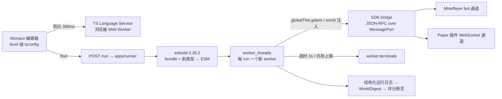

# 语言 / macro / sandbox / 渐进式调研笔记

> 状态：v1 初稿（Lead 采信前请抽查「验证方法」）｜负责人：scout-language｜最后更新：2026-10-31｜上游依赖：BRIEF.md v1（2026-10-31）
> 事实口径：标【事实】的条目于 2026-10-31 通过 npm registry、官方文档或 GitHub 页面核实，链接见文末来源清单；标【判断】的是我的推论。版本号一律以 `npm view` 查询日为准。

## TL;DR（10 条）

1. 【事实】TypeScript **没有宏**：JS/TS 没有学生可用的编译期语法展开；Babel/SWC 插件是「我们替学生展开」，不是学生写宏。
2. 【事实】`babel-plugin-macros` 停在 3.1.0（最后发布 2023-04-29，仓库 2023-05-30 后无推送），而 Babel 8 已于 2026-06-16 发版并转 ESM-only——当地基是负债。【判断】不用。
3. 【事实】pipeline operator 仍是 TC39 **Stage 2**（提案 README 自标；2026-01 仍有会议记录），Babel 插件 `@babel/plugin-proposal-pipeline-operator` 8.0.1（2026-06-17，peer `@babel/core ^8.0.0`）存在，但 topic 占位符等语法未定。【判断】不教、不依赖。
4. 【事实】decorators 与 decorator metadata 均 TC39 **Stage 3**，TypeScript 5.0 起支持标准 decorators。【判断】只可能用于 SDK 元数据，学生不学。
5. 【事实】备选语言存活状态见第 2 节：Racket v9.3（2026-08-13）、Hedy 26.10.17、ReScript 12.3.1 活跃；sweet.js 与 ttypescript 已停更。
6. 【事实】执行侧：Node 文档明写 `node:vm` **不是安全机制、不要跑不可信代码**；权限模型自称「安全带」，不防恶意代码。`isolated-vm` 处于 maintenance mode，Node 22 只能用 5.x（7.x `engines` 为 `>=26`），本机 Node 22.23.1 装 7.x 直接失败。
7. 【事实】TypeScript 7.0（原生 Go 编译器）已发布（npm latest 7.0.2，7.0.0 发布于 2026-07-08），但编程 API 全挂在 `unstable/*` 下；官方公告明确「依赖某些 API 或遗留配置的项目必须使用 TypeScript 6」（6.0.3，2026-04-16）。
8. 【判断】推荐管线：Monaco 内 TS 语言服务做诊断 → esbuild 0.28.2（2026-08-08）剥类型并打包 → 每次 Run 起一个 `worker_threads`，动态 import 学生 bundle，超时 `terminate`。
9. 【判断】学生代码不出现 import：`golem` / `world` 由 runner 注入为全局，允许顶层 `await`；类型错误只在编辑器提示、**不阻断运行**。这是「hide the noise」最重要的承诺。
10. 【判断】D1 成立：TS 是可行且 4 天内性价比最高的选择；但应把「学生语言 = TypeScript」收窄为「TS 子集 + 不教宏 + 类型后置 + 类型错误不阻断」。

## 1. 直接回答：TypeScript 有没有 macro？

**结论：没有。** TypeScript 不提供用户定义宏、卫生宏或语法扩展；tsc 只做类型检查与降级，没有编译期展开钩子。替代物都达不到 Rust `macro_rules!` 的体验。

| 机制 | 2026-10 状态【事实】 | 能做到什么 | 代价 | 给新手用 |
|---|---|---|---|---|
| babel-plugin-macros | 3.1.0；npm 2023-04-29、仓库 2023-05-30 后无推送，12 个 open issues | 按导入名替换为编译期函数产出（语法树变换） | 依赖 Babel；Babel 8 ESM-only 兼容未验证；维护停摆 | 否 |
| ts-patch + 自定义 transformer | 4.0.1（2026-05-01）；README 写「v4 只支持 TS 6+」 | 在 tsc 编译流程里挂 transformer，可加诊断、改 AST | 需 patch 编译器；TS 7 原生兼容性未验证（很可能不成立） | 否（内部工具） |
| ttypescript | 1.5.15（2023-08-05），已停更 | 旧式 transformer 加载器 | 与 TS 5+ 脱节 | 否 |
| sweet.js | 3.0.15（2023-01-04），已停更 | 真正的卫生宏（独立语言） | 生态死、工具链旧、不能复用 TS 类型 | 否 |
| Babel 自定义插件 | `@babel/core` 8.0.10（2026-10-29） | 任意语法树改写，可模拟小型宏 | 自己写自己测；Babel 8 是 ESM-only，包配置更复杂 | 仅内部 |
| SWC wasm 插件 | `@swc/core` 1.16.21（2026-10-31） | Rust 写插件编译成 wasm，接入 SWC 编译链 | 开发成本远高于 Babel；细节未验证 | 否 |
| tagged template / JSX | 语言标准特性，稳定 | 用函数调用制造「像 DSL」的写法 | 只是普通函数调用，无编译期展开 | 是（推荐） |
| pipeline operator | TC39 Stage 2；Babel 插件 8.0.1（2026-06-17） | `value |> f` 链式表达式 | 语法未定，不能进生产 | 否 |
| decorators | TC39 Stage 3；TS 5.0+ 支持 | 类/方法元编程 | 对函数式教学路线帮助小 | 否 |

最小示例（tagged template 的能力上限）：

```ts
// 事实：下面两行都是普通函数调用，运行时才执行；没有任何编译期展开。
const door = defineEntity({ id: "door", at: [10, 64, 10],
  on: { interact: () => world.say("吱呀——门开了") } });

const script = scene`当 ${door} 被打开时，播放 ${sound("bell")}`;
```

【判断】想要「Rust/Lisp 式宏体验」现实只有三条路，且都不该进 4 天课程：① 我们自己写 Babel 插件把一两个语法糖变成展开规则——工程手段，学生感知不到「宏」；② 用 SDK builder + tagged template 伪装 DSL，教学上够用（「给物体写逻辑」本质是回调/声明式对象）；③ 换语言，Racket 的 `#lang` 与宏是唯一真能给学生宏体验的选项，但 MC 集成、AI 实现速度、工具链全部变差（见第 2 节）。

## 2. 备选语言对比矩阵

评分 1–5（5 最好），判断基于 4 天/单团队/AI 主力约束。

| 语言/方案 | 2026-10 状态【事实】 | 新手友好 | 抽象覆盖（ADT/接口/异步/并发） | MC 集成成本 | 4 天 AI 实现 | 工具链/补全 | 结论 |
|---|---|---|---|---|---|---|---|
| TypeScript | TS 6.0.3 / 7.0.2 活跃 | 4（靠隐藏噪音可到 5） | 5（承载 ADT/泛型；async 原生） | 低（mineflayer 在 JS 生态） | 5 | 5（Monaco + tsserver） | **选用** |
| Racket | v9.3（2026-08-13） | 2（括号 + 工具链） | 5（宏、`#lang`、Typed Racket） | 高（无成熟 MC 客户端） | 2（AI 要写 bridge） | 3（DrRacket 强，编辑器集成弱） | 否决（工程不可行） |
| 自造语言 | 无 | 3 | 3 | 5（最高） | 2 | 2 | 否决（4 天做不出 parser+运行时+工具链） |
| Hedy 式渐进 | 26.10.17 活跃 | 5 | 2（Python 子集，无类型/ADT） | 高（无 API 注入设计） | 2 | 4 | 只借鉴「渐进」理念，不用其实现 |
| Pyret | 官网在线、仓库未归档（12,151 commits），活跃度未核实 | 4 | 4（ADT、类型检查、测试） | 高（无 JS 桥） | 2 | 3 | 否决 |
| Scala 3 | 最新 release 3.3.9（LTS） | 2 | 5 | 高 | 2 | 3 | 否决 |
| ReScript 12.3.1 | 活跃 | 3 | 4 | 中（可编译到 JS） | 3 | 3 | 否决（生态小） |
| Gleam v1.19.2 | 活跃 | 3 | 4 | 中 | 3 | 3 | 否决（BEAM/JS 双后端，学习成本） |
| Elm | npm latest 0.19.3-0（2026-10-05），正式版长期停在 0.19.1（2019，待核） | 3 | 3（无类型类、无 async） | 高 | 2 | 3 | 否决 |
| Python | 主流、稳定 | 5 | 3（类型可选、async 有） | 中（需 JS bridge） | 4 | 5 | 次选（TS 崩了可退，但 MC 生态弱） |

两点先例。**Hedy**：README 明确「用不同 level 逐步引入语法」，第一级只有 print/input——支持「按 Act 渐进 + 预填骨架」的合法性；但目标语言是 Python，也没有「代码结果映射到 3D 世界」的 API 注入设计。**SICP JS**：Source Academy 用 JavaScript 承载 SICP 的深层抽象（高阶函数、数据抽象、解释器），证明「主流 JS + 强脚手架」能教到很深；代价是配套编辑器、语言子集与自动评分，正是我们要复刻的部分（[SICP JS](https://about.sourceacademy.org/learner/README.html)）。

## 3. 「Hide the noise」技术清单

| # | 手段 | 具体实现 | 验收标准 |
|---|---|---|---|
| 1 | 预填骨架 / Parsons | level spec 的 `starter` 写初始 buffer；Parsons 模式打乱行、拖拽排序、禁键盘输入 | 每关首屏可点 Run 且不报语法错 |
| 2 | 领域 SDK | 只有 `golem.*` / `world.*` 语义动词（`moveTo`/`mine`/`place`/`say`/`spawn`/`when`），无 RPC/packet 名 | 学生代码不出现 socket/JSON |
| 3 | 编辑器补全 | Monaco `addExtraLib` 注入 `loom.d.ts`（含 `declare const golem/world`）；`setCompilerOptions` 按 level 覆盖 | 输入 `golem.` 有中文注释的补全 |
| 4 | 诊断→人话 | `getTypeScriptWorker()` 取 diagnostics，按码映射中文模板并填标识符名；只显示第一条 error | 任一新手的典型错误都能给「哪里错 + 怎么改」两句 |
| 5 | 渐进 strict | 见下表；tsconfig 片段存在 level spec 里，由 runner 合并 | 同一份代码在三个 Act 下报错条数递减 |
| 6 | 禁 JS 怪癖 | 不上 ESLint（浏览器太重）；AST 检查 4 条：`var`、`==`、`while (true)`、`eval` | 命中即提示，不阻断运行 |
| 7 | 隐藏 imports / 构建 / 终端 | 编辑器不提供 import；runner 注入 `globalThis.golem/world` 后再 import 学生 bundle；UI 无 npm/终端，只有「世界反馈」面板 | 学生文件只有函数体与调用 |
| 8 | 只报第一个错 | 语法错误阻断运行并显示 1 条；类型错误只做编辑器标注，**不阻断** | 新手不会看到错误墙 |
| 9 | 自动格式化 | 保存/Run 前用 prettier standalone（或服务端）格式化，学生看不到配置 | 代码缩进始终一致 |
| 10 | 异步噪音 | 学生代码允许顶层 `await`（ESM 动态 import 天然支持）；Act 1 一句话解释「动作要时间」，不引入 Promise 术语 | L01 代码含 `await` 且新手不困惑 |

渐进 tsconfig（【判断】按 Act 放宽/收紧的具体参数，写进 `content/level-spec.schema.json`）：

| Act | 关键选项 | 理由 |
|---|---|---|
| Act 1（L01–L03） | `strict: false`、`noImplicitAny: false`、`lib: ["ES2022"]`（无 DOM） | 只有顺序/变量/分支/循环，不出类型错误 |
| Act 2（L04–L06） | `noImplicitAny: true`、`strictNullChecks: false` | 引入函数/接口；先让「参数没类型」可被补全提示 |
| Act 3（L07–L10） | `strict: true` | 引入 ADT/闭包/异步/并发，此时类型是教具 |

**永不开启**：`noUnusedLocals`、`noUnusedParameters`、`exactOptionalPropertyTypes`、`noUncheckedIndexedAccess`（都会淹没新手）。

新手最常见 TS 报错码与翻译思路（`tsc` 5/6 码表；TS 7 是否沿用未逐条验证）：

| 码 | 触发场景 | 翻译模板（中文人话） |
|---|---|---|
| TS2304 | 变量/函数名拼错或未声明 | 「找不到 `{name}`：检查拼写，或它在别的关卡才教」 |
| TS2322 | 值赋给不兼容类型 | 「`{expr}` 是 {A}，但这里是 {B}」 |
| TS2345 | 函数实参类型不符 | 「第 {n} 个参数需要 {B}，你给的是 {A}」 |
| TS2554 | 参数个数不对 | 「`{fn}` 需要 {n} 个参数，你给了 {m} 个」 |
| TS2339 | 属性不存在 | 「{T} 没有 `{prop}` 这个属性；可用：{list}」 |
| TS2551 | 属性拼写相近 | 「你是想写 `{suggest}` 吗？」 |
| TS7006 | 参数隐式 any（Act 2 起） | 「给参数 `{name}` 加类型，例如 `{name}: number`」 |
| TS7031 | 解构元素隐式 any | 「解构出来的 `{name}` 需要类型标注」 |
| TS2531 / TS18047 | 可能为 null | 「`{expr}` 可能是空的，先 `if (...)` 判断」 |
| TS18048 | 可能为 undefined | 「`{expr}` 可能是 undefined，用 `??` 给默认值」 |
| TS2367 | 比较永不成立 | 「{A} 和 {B} 永远不相等，检查比较的两边」 |
| TS2741 | 对象缺必填字段 | 「{T} 还缺字段 `{field}`」 |
| TS2353 | 对象字面量多写字段 | 「{T} 没有 `{extra}`，是不是拼错了？」 |
| TS2454 | 变量未赋值就使用 | 「`{name}` 还没赋值就被用了」 |
| TS2448 | 声明前使用 | 「`{name}` 要在使用前定义」 |
| TS1005 / TS1128 / TS1109 | 语法错误（缺括号/分号） | 「第 {line} 行附近好像少了 `{token}`」 |
| TS2307 | 找不到模块（我们不该出现） | 「这个关卡不需要 import；直接用 `golem` / `world`」 |

## 4. Sandbox / 执行管线（2026 现状）

关键【事实】：

- `node:vm` 官方原文：**"The `node:vm` module is not a security mechanism. Do not use it to run untrusted code."**（[Node vm 文档](https://nodejs.org/api/vm.html)，2026-10-31 查，文档版本 v26.13.0）。
- Node 权限模型是 **"seat belt"**，防「可信代码误操作」，**"does not provide security guarantees in the presence of malicious code"**（[Node Permissions 文档](https://nodejs.org/api/permissions.html)）。本机 Node 22.23.1 的 `v22.x` 文档同页标注 `Stability: 2 - Stable`，可用 `--permission --allow-fs-read=...` 白名单。
- `isolated-vm`：7.0.2（2026-10-30），README 自述 **maintenance mode**；Node 22.x → 5.x/4.x，24.x → 6.x/5.x，26.x → 7.x；`engines` 显示 7.x 要求 `node >= 26`、5.x 要求 `>= 18`。**本机 Node 22.23.1 不能用 7.x。**
- 转译/打包：`esbuild` 0.28.2、`tsx` 4.23.15 均活跃；esbuild 的 plugin API（`onResolve`/`onLoad`）可在解析前替换源码，足以挂我们自己的预处理器。
- 类型检查：`typescript` 7.0.2 的 `exports` 只有 `./unstable/{fs,ast,sync,async,proto}` 等入口，稳定 Compiler API 锁 **6.0.3**；诊断由 Monaco TS worker 负责，服务端不跑 tsc。

威胁模型【判断】：课堂项目的风险是「死循环/内存/卡死/误删」，不是恶意逃逸；worker + 超时 + 能力注入足够，不需要原生 isolate。



推荐形态【判断】：

- 学生代码编译为 **ESM**，worker 里 `await import(tempFileURL)`——顶层 await 天然可用，不用包装 `async function main()`；
- SDK 通过 `globalThis` 注入，学生不写 import；`worker.terminate()` 可打断同步死循环（**Day 0 冒烟验证**，见第 8 节）；
- 可选「温和版」循环预算：Babel `@babel/traverse` 在 `for/while` 体首插 `__budget.tick()`，超预算抛「循环跑太久了」；这是体验优化，不是安全边界；
- 异步取消：每次 RPC 带超时（500ms），run 级传 `AbortSignal`，超时先 cancel 再 terminate；
- 多文件 import：Act 3 才需要，esbuild `bundle:true` 一次打包，学生看不到构建。

包结构建议：

```
packages/sdk/          @loom/sdk         类型 + worker 侧 client，无 node-only 依赖
packages/runner/       @loom/runner      esbuild + worker + RPC bridge + 超时
packages/errors/       @loom/errors      诊断码 → 中文模板（纯数据 + 单测）
packages/level-spec/   @loom/level-spec  schema + validator + 按 Act 的 tsconfig 片段
apps/studio/           Vite + React + Monaco
apps/runner/           Node 22 服务；与 studio 同进程亦可
```

## 5. 学生该不该写 TS 类型？

【判断】**该写，但后置到 Act 2**，且类型错误永不阻断运行。类型是「让错误提前出现」的工具，对新手是双刃剑：先让「程序能跑、世界有反应」建立动机，再让类型成为「魔像的契约」。

教学梯度（可直接写进关卡 spec）：

| 阶段 | 类型内容 | 代码样例 |
|---|---|---|
| Act 1（L01–L03） | 零类型注解，只用 `let` / `const` | `const 木材 = await golem.mine("oak_log", 3)` |
| Act 2（L04–L06） | `type` 别名、`interface`、函数参数/返回值 | `interface 任务 { 名称: string; 数量: number }` |
| Act 3（L07–L10） | 泛型、union/ADT、`async` 返回类型 | `type 符文 = { kind: "move"; dx: number } \| { kind: "place"; block: Block }` |

TS 类型系统足以承载我们要教的抽象（【判断】，代码可直接用于 L07/L09）：

```ts
type 事件 =
  | { kind: "blockPlaced"; block: Block; at: Vec3 }
  | { kind: "playerNear"; name: string; distance: number }
  | { kind: "tick"; day: number };

interface 魔像<T> {
  run(task: (input: T) => Promise<void>): Promise<void>;
  map<U>(f: (value: T) => U): 魔像<U>;      // Act 3：高阶 + 泛型
}

const 巡逻 = (golem: 魔像<Vec3>) => golem.map(v => v.add(1, 0, 0));
```

注意【判断】：泛型与 `map/filter/reduce` 是 Act 3 内容，Act 1 补全里不要出现，否则「autocomplete 即课程表」会提前泄露概念。

## 6. 与 MC API 的绑定方式

目标：学生只看到两个对象、全 `async`、错误是人话、取消透明。

```ts
// @loom/sdk —— 学生可见的世界接口（.d.ts 原文，注入 Monaco）
export interface Golem {
  moveTo(x: number, y: number, z: number): Promise<void>;
  mine(block: BlockName, count?: number): Promise<number>;
  place(block: BlockName, x: number, y: number, z: number): Promise<void>;
  say(text: string): Promise<void>;
  wait(seconds: number): Promise<void>;
  readonly position: Vec3;
}

export interface World {
  when(event: 事件, handler: (e: 事件) => void | Promise<void>): () => void;
  spawn(kind: "zombie" | "villager", at: Vec3): Promise<EntityId>;
  setBlock(block: BlockName, at: Vec3): Promise<void>;
  say(text: string): Promise<void>;
  readonly day: number;
}
```

绑定要点（【判断】）：

1. **逻辑 API 单一、物理通道双份**（呼应 D2）：`golem.*` 走 Mineflayer，`world.*` 走 Paper 插件，学生无感；两边共用 `RunContext`，评分看世界快照而非通道日志。
2. **能力注入**：runner 只把 `golem` / `world` 塞进 `globalThis`（由 SDK 的 `createRuntime(rpc)` 构造），不暴露 `process`、`require`、`fetch`（worker 里虽存在，但不在补全与文档中；硬隔离再加 `--permission`）。
3. **错误语义化**：通道错误在 bridge 层映射为 `GolemError` / `WorldError`（含 `code`、`humanMessage`），学生只看到「魔像被石头挡住了」，绝不透出 WebSocket/JSON-RPC。
4. **事件订阅返回 unsubscribe**：`when(...)` 返回函数，Act 3 讲「取消订阅/资源清理」时有真实载体。
5. **类型即文档**：`.d.ts` 每个方法写中文 JSDoc + 一句 use case，Monaco hover 直接显示。

## 7. 对项目的直接建议（可执行）

1. **`docs/03-language-decision.md` 把 D1 收窄为四句硬约束**：只用 TS 子集；不教宏；类型后置到 Act 2；类型错误不阻断运行。第 3 节的 10 条 hide-noise 手段列为 Level 验收项（每条给勾选项）。
2. **先落地 `packages/errors`**：第 3 节约 20 个错误码 → 中文模板的单测（输入 fixture 诊断 JSON，输出字符串快照），命令 `npm test -w @loom/errors`。这是 4 天里性价比最高的体验投资。
3. **Day 0 做三组冒烟**（各 10 分钟）：(a) Node 22.23.1 下 worker 死循环 `terminate` 生效；(b) esbuild 打包含相对 import 的 TS → ESM → `await import()` 成功且顶层 await 生效；(c) Monaco 0.57.0 的 TS worker 在自定义 `.d.ts` 下能补全 `golem.`。
4. **不要引入**：babel-plugin-macros、sweet.js、ttypescript、isolated-vm、pipeline operator 插件——引入即增加 Node 26 / Babel 8 的版本债。
5. **锁版本**：`typescript@6.0.3`（编译器 API 与 tsserver）、`monaco-editor@0.57.0`、`esbuild@0.28.2`、`@babel/core@8.0.10`（仅内部预处理器）；所有 package.json 用 `"type": "module"`。
6. **课程语言表先于关卡写**：把 `async/await`、`type`、`interface`、`泛型` 映射到 MC 叙事（如 `await` = 等魔像走完这段路），由 Lead 在 `docs/04-learning-design.md` 统一，避免各关卡作者各写一套。

## 8. 不确定 / 未验证事项 + 验证方法

| 事项 | 风险 | 验证命令/方法 |
|---|---|---|
| ts-patch 4 对 TS 7 原生编译器是否可用 | 若不可用，自定义 transformer 路线只能锁 TS 6 | `npm view ts-patch@4.0.1 readme`；读 README 兼容性节；在 TS 6.0.3 下跑一个最小 transformer |
| Babel 8 ESM-only 对 `babel-plugin-macros` 的实际兼容性 | 若还可用，也只是遗产方案 | 在 `/tmp` 建最小工程 `npm i @babel/core@8 babel-plugin-macros@3.1.0` 跑 transform（勿装进项目） |
| SWC wasm 插件细节（是否支持 AST 级访问、构建成本） | 高估/低估成本 | 官方文档 + 最小 demo；本轮未打开验证 |
| decorators / decorator metadata 在浏览器/Node 的原生支持 | 若原生未支持，需 Babel 转译 | caniuse + `node --version` 下的 REPL 试验 |
| Pyret 近期活跃度 | 影响对比矩阵可信度 | `curl -s https://api.github.com/repos/brownplt/pyret-lang/commits?per_page=1`（本轮 GitHub API 限流未取到） |
| Elm npm latest 0.19.3-0 的含义（预发布/乌龙） | 影响「Elm 是否复活」判断 | `npm view elm time --json` + GitHub releases |
| Hedy 当前 level 总数（约 18，未核实） | 只影响教学法引用的精度 | `curl -s https://raw.githubusercontent.com/hedyorg/hedy/main/README.md` 与 hedy.org 文档 |
| worker.terminate 打断同步死循环 | 若不可靠，需换子进程 | `node -e` 起一个 worker 跑 `while(true){}`，100ms 后 terminate，观察 exit |
| TS 7 `unstable/*` API 是否够做单文件 transpile | 决定服务器端是否需要 tsc | `npm pack typescript@7.0.2` 后读 `dist/api` 类型；或先用 esbuild 本地方案 |
| Monaco 0.57.0 与内置 TS 版本差异导致的诊断不一致 | 学生看到与 runner 不同的报错 | 在 studio 里对 3 个 fixture 比对诊断码 |

## 9. 来源清单（均于 2026-10-31 查询）

- npm registry（`npm view <pkg> version time.modified`）：`babel-plugin-macros@3.1.0`（2023-04-29）、`ts-patch@4.0.1`（2026-05-01）、`ttypescript@1.5.15`（2023-08-05）、`sweet.js@3.0.15`（2023-01-04）、`isolated-vm@7.0.2`（2026-10-30，engines `>=26`）、`esbuild@0.28.2`（2026-08-08）、`tsx@4.23.15`（2026-09-20）、`typescript@7.0.2` / `6.0.3` / `5.9.3`、`@babel/core@8.0.10`、`@babel/plugin-proposal-pipeline-operator@8.0.1`（2026-06-17，peer `@babel/core ^8.0.0`）、`monaco-editor@0.57.0`（2026-09-24）、`@swc/core@1.16.21`（2026-10-31）、`rescript@12.3.1`（2026-09-16）、`elm@0.19.3-0`（2026-10-05）。
- TC39 proposals 列表：<https://github.com/tc39/proposals>（2026-10 抓取：Decorators、Decorator Metadata、ShadowRealm 在 Stage 3；Pipeline Operator 在 Stage 2）。
- Pipeline Operator 提案：<https://github.com/tc39/proposal-pipeline-operator>（Stage 2；`%` 占位符「almost certainly not the final choice」）。
- Babel 8 发布公告：<https://babeljs.io/blog/2026/06/16/8.0.0>（ESM-only）。
- TypeScript 原生移植公告：<https://devblogs.microsoft.com/typescript/typescript-native-port/>（原文：部分项目「necessitate using TypeScript 6」）；TypeScript 6.0 公告：<https://devblogs.microsoft.com/typescript/announcing-typescript-6-0/>（2026-03-23）。
- TypeScript 7.0 发布侧记：<https://www.infoq.com/news/2026/08/typescript-7-released/>（2026-08）。
- Node 文档：<https://nodejs.org/api/vm.html>（vm 安全警告）、<https://nodejs.org/api/permissions.html>（seat belt、不防恶意代码）。
- isolated-vm README：<https://github.com/laverdet/isolated-vm>（maintenance mode；Node 22→5.x、26→7.x 的 ABI 表）。
- Racket v9.3：<https://github.com/racket/racket/releases/tag/v9.3>（2026-08-13）。
- Hedy：<https://github.com/hedyorg/hedy/releases/tag/26.10.17>（2026-10-17）；README「gradual programming language…teaching Python」。
- SICP JS / Source Academy：<https://about.sourceacademy.org/learner/README.html>。
- Gleam v1.19.2：<https://github.com/gleam-lang/gleam/releases/tag/v1.19.2>；Scala 3 latest release：<https://github.com/scala/scala3/releases/tag/3.3.9>；Pyret：<https://pyret.org/>。

## 10. 如果只能改 BRIEF 里一条决策

**我改 D1，但不是改语言选择，而是改它的承诺边界。** 改为：

> 学生语言 = **TypeScript 子集**：运行时用 esbuild 剥类型、不跑 tsc；类型服务锁 TypeScript 6.0.3（不用 TS 7 原生编译器的 `unstable` API）；类型错误只提示、不阻断运行；**不承诺宏体验**——用户的「给物体写逻辑」诉求由 SDK 的 `defineEntity({ on: {...} })` + tagged template 满足，宏系统不进课程。

理由：（a）证据支持 TS 是唯一同时满足「真实主流语言 + MC 生态 + 4 天 AI 实现」的选项，D1 的结论对；（b）但不把「TS 没有宏」写进决策，后续文档会反复被「能不能上 macro」拉扯，浪费 Lead 与实现 agent 的时间；（c）类型后置与「类型错误不阻断」是控制新手挫败的关键开关，属于 D1 而非实现细节。反方风险：写死成子集后，若后续想用类型级编程做亮点，需 Lead 明确豁免；建议在 `docs/03-language-decision.md` 留一行「豁免需 Lead 书面确认」。
